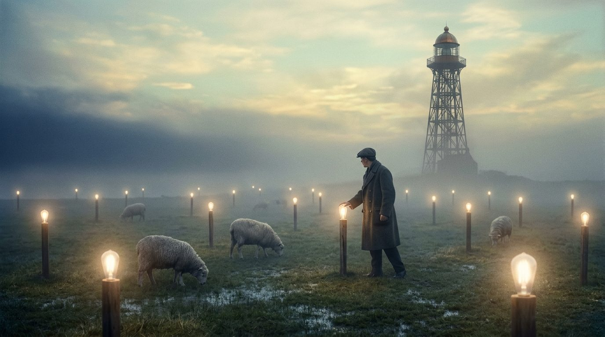
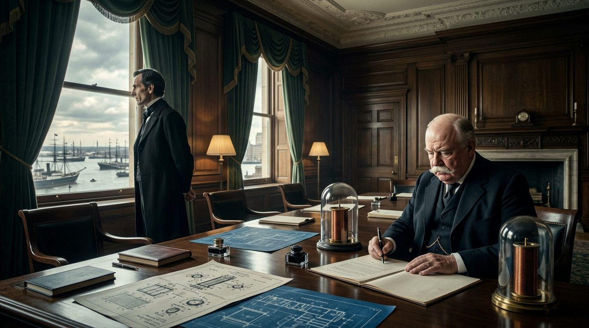
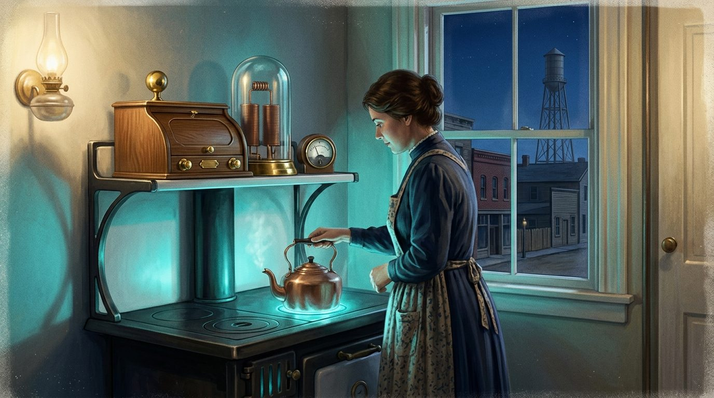
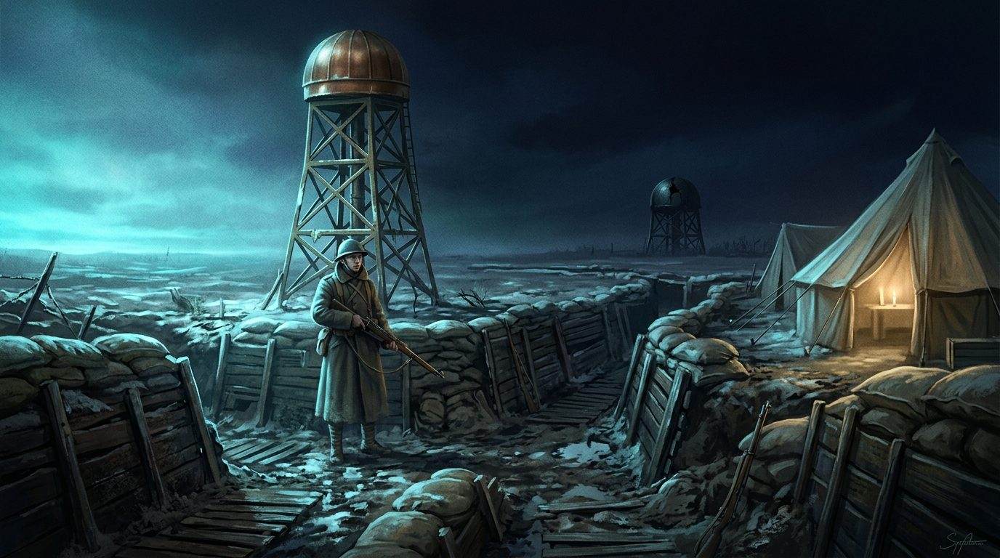
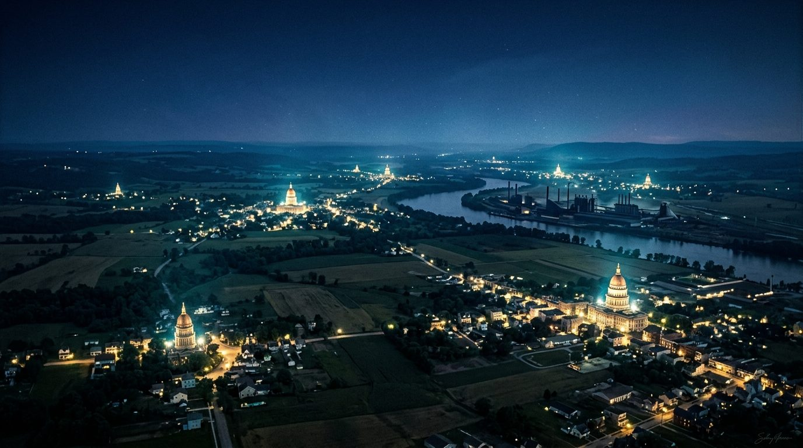
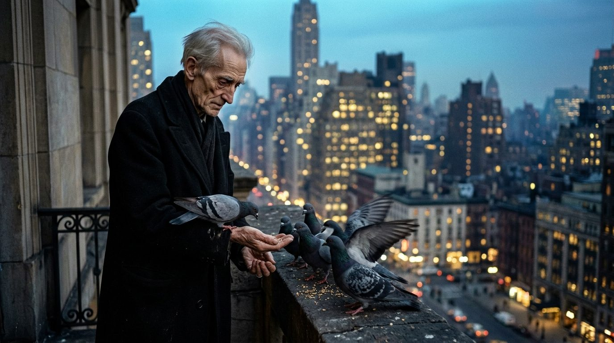
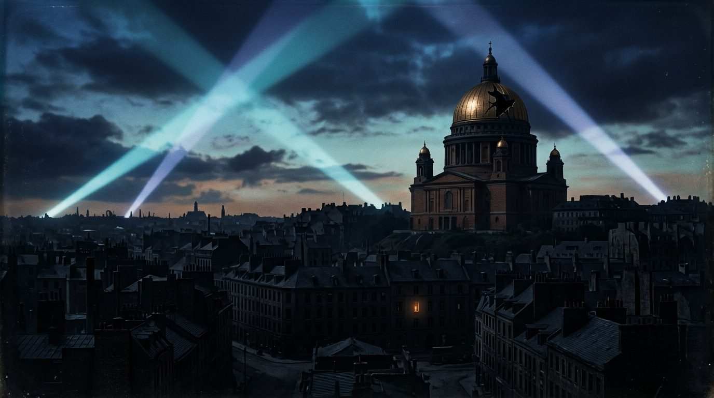
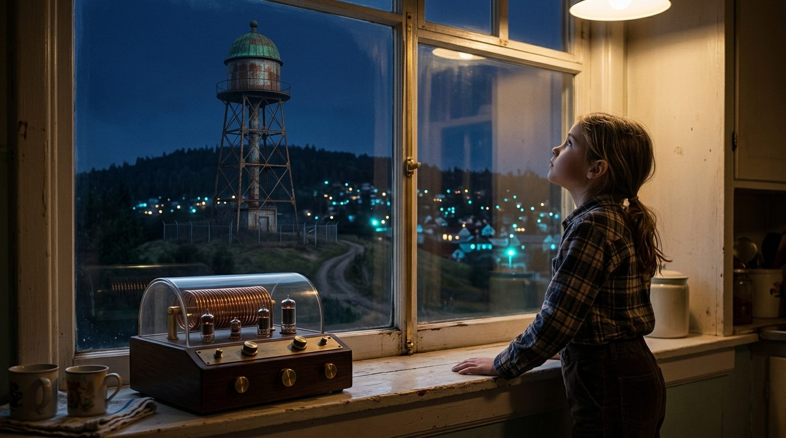

# The Radiant Age

> **What if…** What if J.P. Morgan had kept funding Nikola Tesla's Wardenclyffe tower, and the world had been built around wireless, broadcast electric power instead of wires?

In the 1880s and 1890s, Edison's direct current fought Westinghouse and Tesla's alternating current for the right to electrify America. AC won the obvious battle: it lit the 1893 Chicago fair and harnessed Niagara two years later. But Tesla's larger dream, the wireless transmission of power itself, stalled. At Wardenclyffe on Long Island he raised a great tower to push energy through the earth. When Marconi flashed a signal across the Atlantic in 1901, his backer J.P. Morgan grew nervous and closed his checkbook. The tower rotted and came down. Here the story bends on one cold morning in March 1903, when Tesla lights a field of lamps a mile from the tower with nothing running to them, and Morgan, watching, decides to keep paying.

## The Field of Lamps

Charles Petit had come to disprove the thing. Morgan's other engineers waited by the motorcars while he walked the wet mile out from the tower, counting his paces, looking for a buried cable. He found grass, a few sheep, and two hundred lamps set on posts in the open field. At the tower a bell rang. The lamps came up together, dim then steady, a cold amber light standing in the fog with nothing running to them. Petit closed his hand around a bulb. Warm. He looked back at the platform, at the tall thin man in the black coat with one arm still raised, and he did not write down what he had come there to write.

## The House of Tesla

Morgan did not smile easily, but he signed. The money came, and lawyers came with it. Marconi had claimed the air; Tesla's patents, older and deeper, took it back in one courtroom after another. By 1906 the works at Shoreham were sending messages to ships, then to Cornwall, then power, real measurable power, to the towns nearest the tower. Westinghouse built the receivers. Farmers who had never seen a wire ran a lamp and a small motor off a copper coil bolted to the barn wall. It was not free and it was not even, but it arrived through the air, and the men who owned the towers began to understand exactly what they owned.

## Cutting the Cord

In Shoreham the Vance kitchen had no wires on the wall and none along the street outside. On a shelf sat a receiver the size of a breadbox, a coil under glass, and beside it a meter that ticked when the stove pulled current. Nora Vance had grown up trimming lamp wicks. Now she boiled a kettle on a plate that glowed from nothing she could point to, and the whole house carried a faint hum you stopped noticing by June. On the hill the tower stood over the town like a water tank. When it went quiet for repairs the street felt wrong, and every kitchen in Shoreham went cold at the same hour.

## The Wireless War

The armies took the towers first. A grid that could light a county could also be switched, and both sides soon learned to aim their guns at copper domes. Private Illingworth spent the winter of 1916 guarding one in Picardy, a British tower feeding the forward lines. When German shells found its neighbor forty miles east, the trench telephones died, the searchlights died, and the field hospital worked by candle for three nights. The beams and the death rays the newspapers wanted never came. What came instead was a war that could be blinded in an afternoon, and commanders who slept badly knowing their light hung from a tower somebody else could break.

## The Radiant Decade

Then the towers went up everywhere. They stood over Chicago and Berlin and Osaka, over railheads on the Argentine pampas, each one throwing power across its own ring of country. The coal trains thinned. Pittsburgh's sky came clean for the first time in a working man's memory, and the miners who had filled those trains drifted to the tower yards or drifted to nothing. A country without a tower bought its current from a country that had one, and paid in more than money. The decade glowed. From an aeroplane at night the Ohio valley looked like spilled embers, town after town lit from a single hub, the dark between them shrinking every year.

## Who Holds the Switch

The question nobody thought to ask in 1903 was who held the switch, and by the thirties everybody asked it. A strike at a single tower could darken three states. A government that owned its towers could darken a city that had voted the wrong way, and one or two quietly did. Doctors argued about the hum, about the invisible fields people now slept inside, and could not agree, which frightened people more than a clear answer would have. The old inventor was still alive, taller and thinner than ever, white-haired, feeding pigeons from a hotel ledge and talking of engines that ran on the spin of the earth. People revered him and kept their distance, the way you do with weather.

## The Slow Fuse

The second great war was fought partly for the switch. Both sides mapped the enemy's towers before they mapped his cities, because a raid that put out a hub did more than a raid that burned a district. Coventry went dark not from fire but from a single dome cracked open at dusk, and it stayed dark, and it learned to keep candles by the door again. The inventor died in a New York hotel in the winter of 1943, owing rent, owning patents worth continents. They put his name on the tower at Wardenclyffe. By then the men who ran the grid had stopped saying his name in their meetings, because the thing was theirs now, and running it was a different trade than dreaming it.

## Weather You Cannot See

A girl born in Shoreham in 1970 had never seen a wire and could not imagine wanting one. Power was weather to her, everywhere and nobody's, until the August the regional hub failed and the whole town remembered at once what it had been sitting inside. The old tower still stood on the hill, fenced off, its latticework rusted and its copper dome gone green, a breadbox-sized receiver sealed in a glass case at its foot. Her grandmother said folks used to string the stuff on poles, house to house, like laundry across the street. The girl laughed at that. Then the lights came back on, humming, and by supper she had stopped hearing them again.

