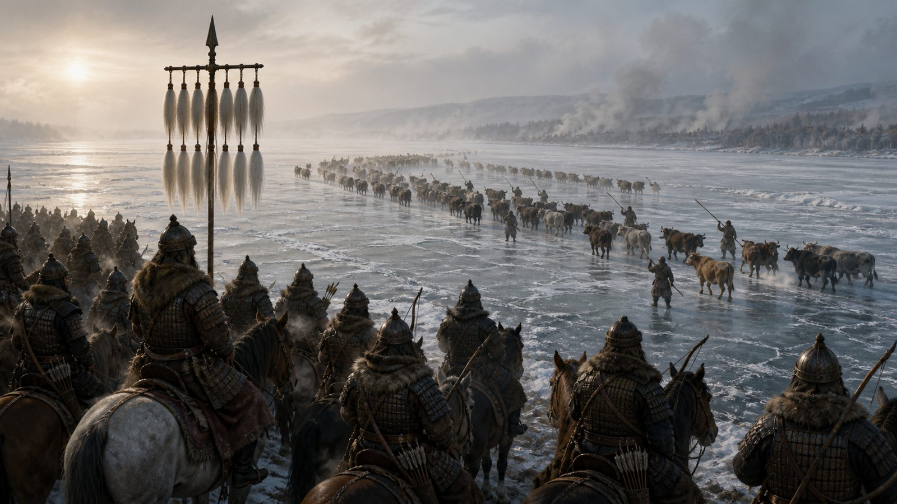
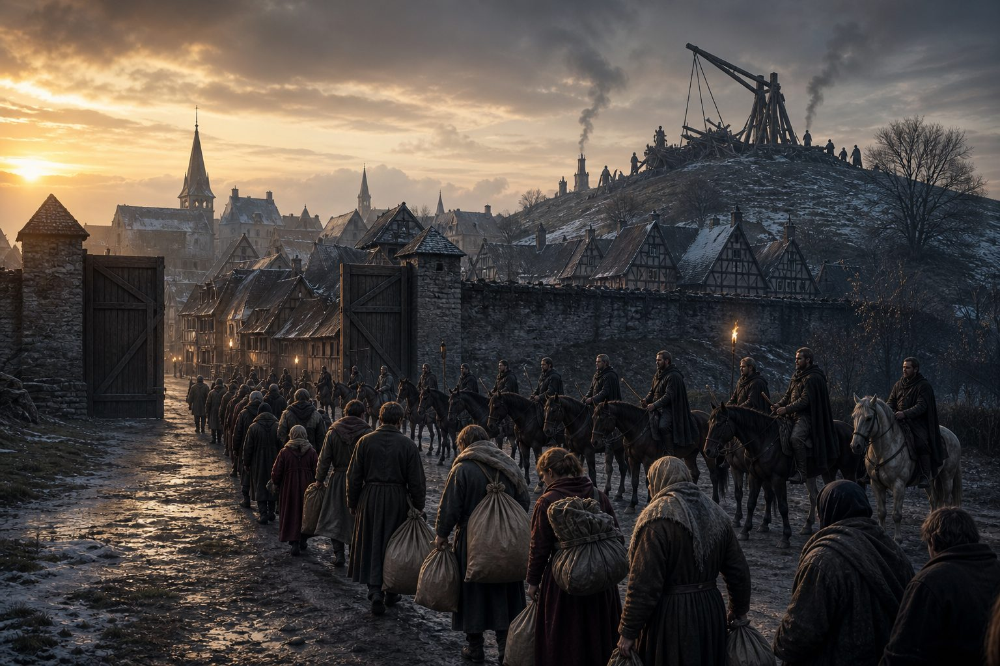
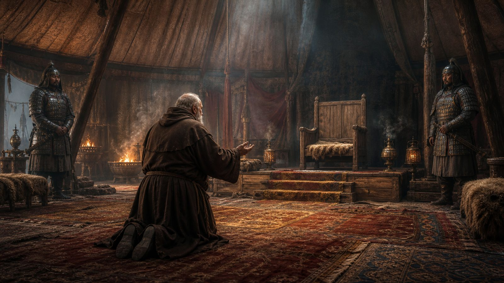
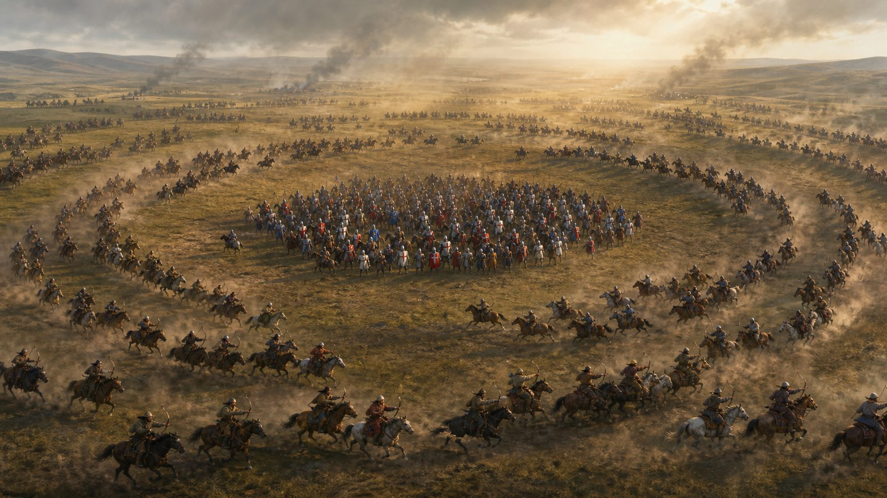
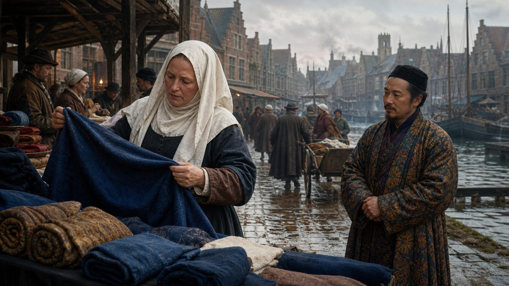
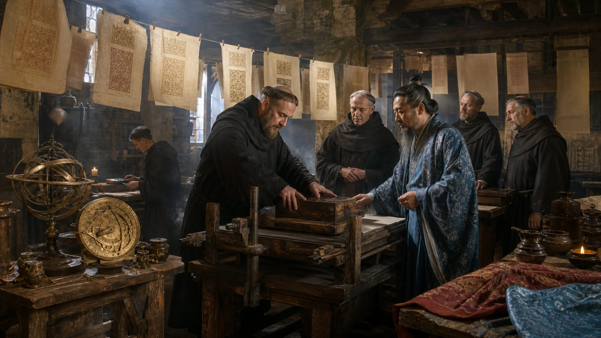
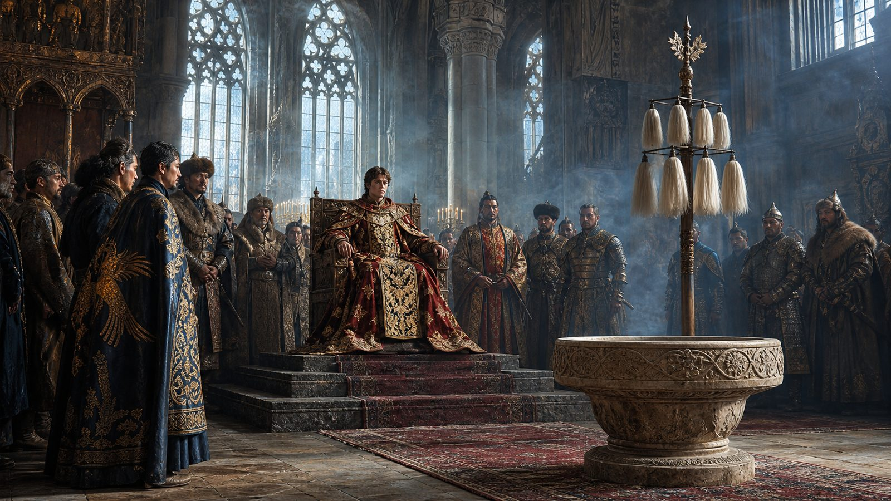
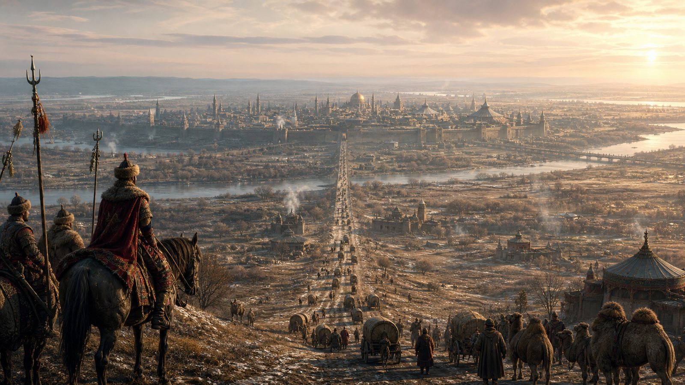

# All Roads Ran East

> **What if…** What if the Mongol army had not turned back at the Danube in 1242, and instead rode on to conquer Western Europe?

In the spring of 1241, two Mongol armies broke Europe's defenses in the same week. At Legnica on 9 April they destroyed a combined Polish and German force; two days later, at Mohi, Subutai crushed the army of Béla IV of Hungary and left the plain open. The road to the Atlantic lay undefended. Then, in December, Great Khan Ögedei died in Karakorum, and the princes of the blood turned their horses east to choose his successor. Europe called it deliverance and mostly forgot how close it had come. This timeline asks a smaller question: what if the courier carrying news of Ögedei's death had frozen in a mountain pass, and Batu and Subutai, hearing nothing, simply kept riding west?

## The courier who never arrived

The Danube froze hard that January, and the Mongols did what they always did with a frozen river. They drove captured cattle across first to test the ice, then followed. Béla IV had counted on the water and now fled toward the Adriatic with horsemen a day behind him. In Karakorum, the succession quarrel that should have called the army home unfolded without it, because the men who mattered were half a world away and did not know their khan was dead. Subutai, old and unhurried, wintered his troops on the Hungarian plain, fattened the horses on captured grain, and drew maps of the German lands from the mouths of Dominican prisoners. He meant to leave in spring.

## The German winter

The German princes never combined. Frederick II, the emperor, was in Italy quarreling with the Pope and would not come north; the dukes who might have fought had died at Legnica or were burying the men who had. Subutai took the towns the way he had taken Chinese cities, with captured engineers and their siege machines, and where a town opened its gates it was spared and taxed. Vienna held for eleven days. Regensburg, watching, did not try. By the time the columns reached the Rhine, Mongol garrisons sat in the Danube towns collecting a tenth of everything and a count of every household. Bishops learned to record baptisms and tribute in the same ledger.

## The Franciscan road

Pope Innocent IV had already fled Rome for Lyon, ahead of Frederick, and now a second shadow moved up the peninsula. From Lyon he did what a man with no army does. He wrote letters and chose messengers. Giovanni da Pian del Carpine, a fat old Franciscan who had known Francis himself, rode east through burned country to kneel in a felt tent and ask the Mongols what they wanted. He came back with an answer that satisfied no one. The khan wanted submission, tribute, and hostages; in return he offered peace and the freedom to keep one's god, provided one prayed for the khan while keeping it. Rome argued for a year over whether that was apostasy or arithmetic.

## The field beyond the Rhine

Louis IX of France was the one king who tried. Pious, stubborn, and not yet the crusader he had meant to become, he called his vassals to the Rhine in the summer of 1248 and met the Mongols on open ground, which was the mistake every Western commander made exactly once. The knights charged and broke the first line, then chased it, because a fleeing Mongol looks like a beaten one. The feigned retreat closed around them by mid-afternoon. Louis was taken alive, ransomed to a khan instead of a sultan, and spent two years in a comfortable tent learning the Mongol postal roads by heart. France paid. Paris kept its walls and lost its independence in the same treaty.

## The tenth and the road

By the 1260s a wool merchant in Bruges could send a letter to Karakorum and expect an answer, which was new. The Mongol post ran on fresh horses every few leagues, and it did not care whose land it crossed. What the towns hated was the census; what they came to lean on was the peace. Aleit, a dyer's widow in Ghent, kept her books in the new fashion the tax-farmers required, and noticed that her indigo now came overland, cheaper, from places she could not pronounce. Her priest still said Mass. A Mongol officer's clerk, a Nestorian Christian from somewhere east, sat through it once out of curiosity and argued theology with the priest afterward, in bad Latin, for hours.

## What came down the roads

The roads carried more than tribute. Paper reached the Rhineland mills a lifetime before it should have, and block printing came with it; the Latin liturgy was among the first things the new presses copied, to the fury of everyone who had made a living copying it by hand. Physicians from the eastern camps set bones better than the barber-surgeons, and were resented for it. Gunpowder arrived as a weapon and stayed as a mining tool. Astronomers trained at Maragha corrected the Church calendar so thoroughly that Easter moved, which caused a small schism no one now remembers. Universities that had argued only Aristotle began arguing him against men who had read further east, and lost often enough to change the questions.

## The khanate of the setting sun

The empire was always too big to hold, and it came apart along the same seams as in the world we know. The western lands fell to the house of Batu's grandsons, who ruled the old German and French country from a camp that slowly hardened into a city near the Danube. Within three generations they had done what conquerors on that ground always do. They took Christian wives, baptized the heirs who would rule Christian subjects, and kept the postal roads and the census and the tolerance because those things paid. A khan who prayed in a cathedral on Sunday and kept the yasa on Monday was a contradiction to no one but the theologians, and the theologians were on the payroll.

## The long view from the Danube

A century and a half on, the map made a different kind of sense. There was no ragged edge of Christendom staring west across an empty ocean, because the edge now faced east, toward the roads and the trade and the power. A boy in what had been France grew up bilingual by necessity and trilingual by ambition, learned his letters from a printed book, and took it for granted that the world was one connected place, because in his lifetime it was. Ships still went out from the Atlantic ports, but to fish and to trade up the known coasts, not to gamble on emptiness. The dream of sailing west to find another road east belonged to men who had no road east. These men had the road.

