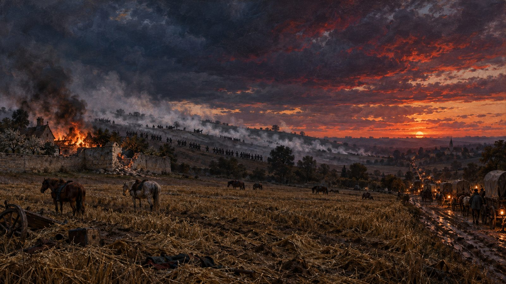
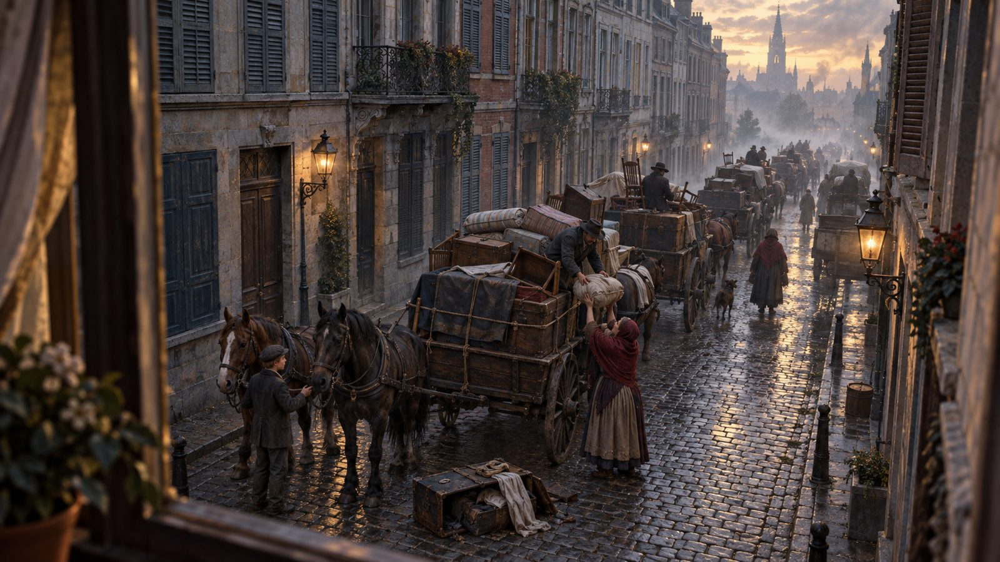
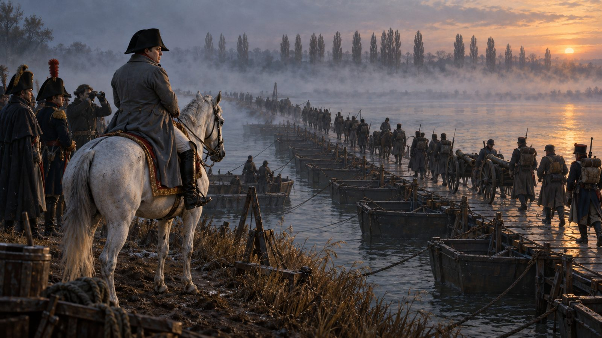
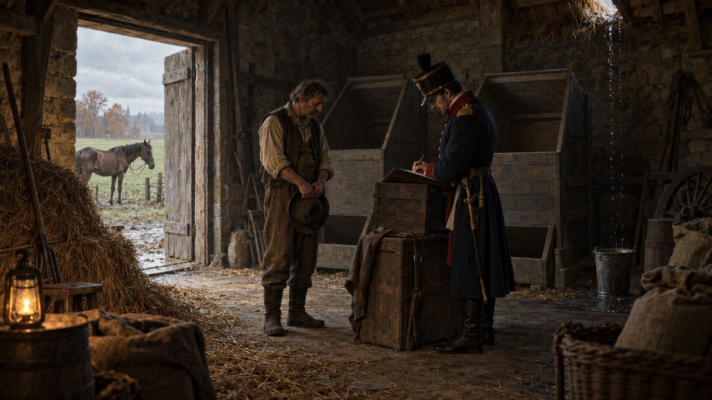
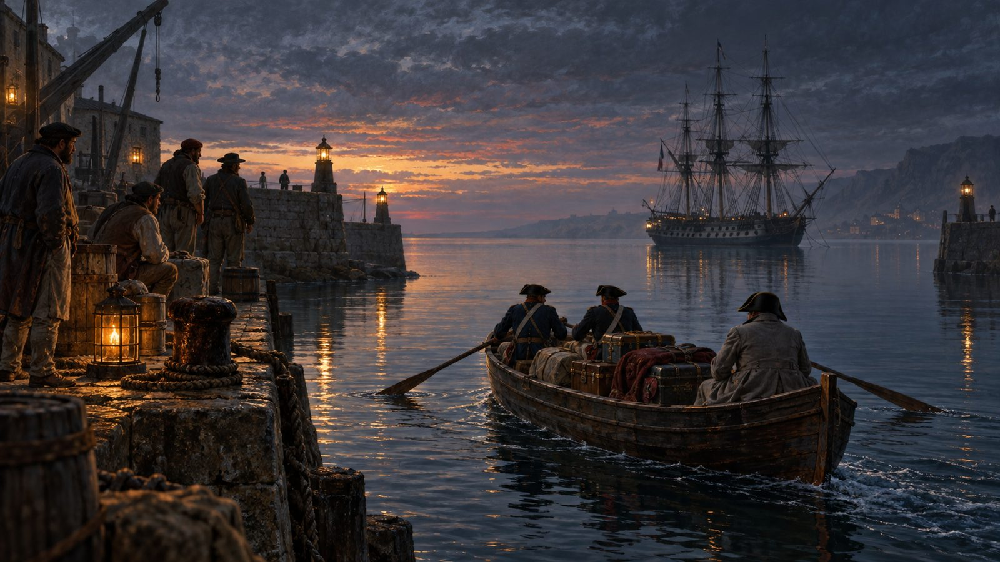
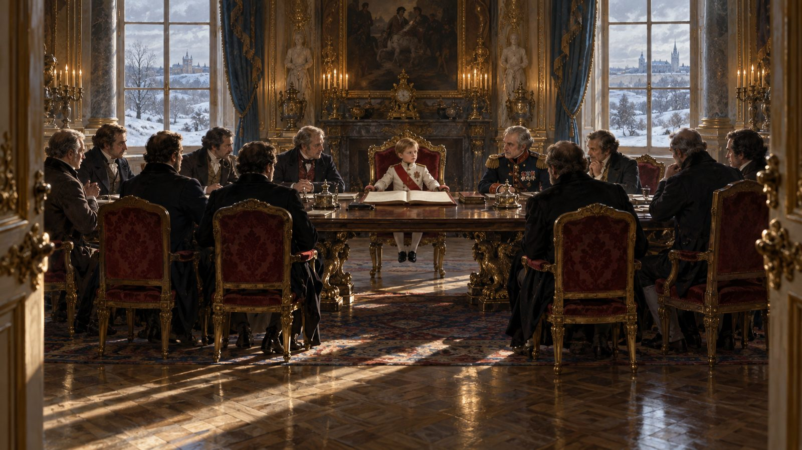
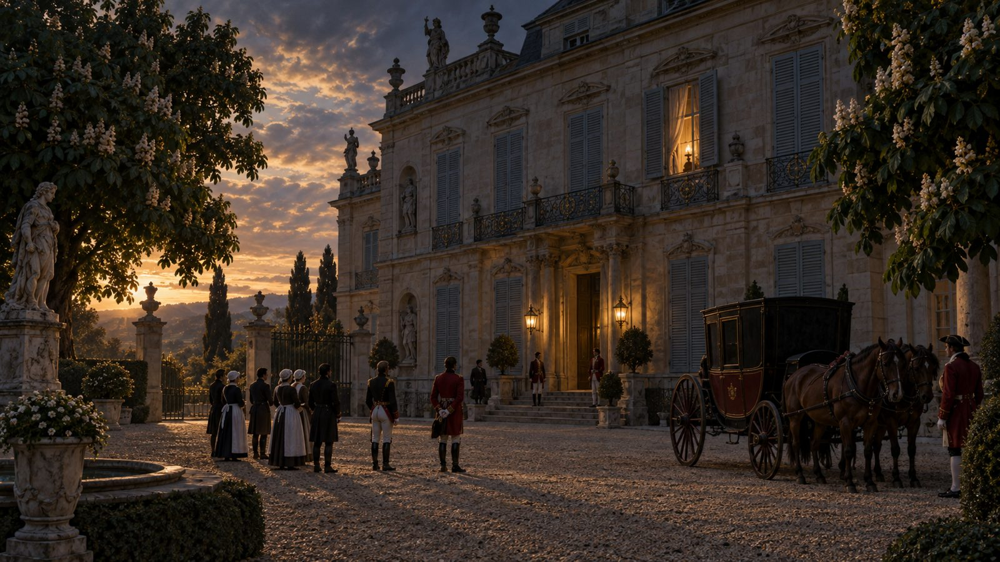
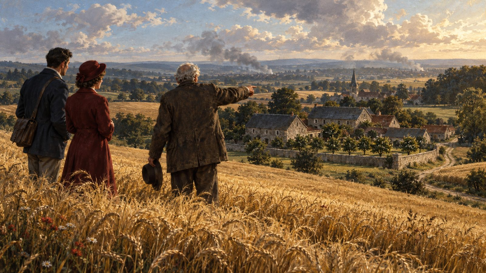

# The Strawberries at Walhain

> **What if…** Marshal Grouchy marches to the sound of the guns on 18 June 1815, the Prussians never reach the field, and Napoleon wins at Mont-Saint-Jean.

Twelve weeks after he came ashore from Elba, Napoleon had seventy-odd thousand men on a wet Belgian ridge and two enemies to beat before they could join hands. He had sent Grouchy east with 33,000 to keep Blücher's Prussians away. Around half past eleven on 18 June 1815, in a notary's garden at Walhain, Grouchy heard the cannon open twelve miles to the west. General Gérard asked leave to march toward the sound. In the history we have, Grouchy refused, continued to Wavre, and by evening Prussian columns were folding in the French right while the Imperial Guard broke against Wellington's infantry on the reverse slope. This is the same day with one word changed. Here Grouchy says yes.

## Strawberries at Walhain

Grouchy was sitting in a notary's garden eating strawberries when the guns opened twelve miles west. Gérard asked to march to them. Grouchy put the bowl down and turned his columns onto the Lasne road.

Bülow's Prussians were strung out in a wooded defile below Chapelle-Saint-Lambert, and at four o'clock French dragoons came into their flank. The Prussians stopped to fight. Nobody reached Plancenoit.

On the ridge, Ney took the farm of La Haye Sainte at six and dragged guns up to within three hundred yards of Wellington's centre. The Guard went in at half past six against a line with nothing left behind it. By nine the Brussels road was one dark column moving north.

## Three Days to Antwerp

Brussels went north for three days. Mattresses were roped onto farm carts for the wounded. The innkeepers on the Rue de la Madeleine took gold first and then took anything.

French chasseurs rode in on the 21st and behaved correctly, which disappointed the people who had spent the spring telling stories about them. Wellington got perhaps thirty thousand men to Antwerp under the guns of the fleet. Blücher, who had lost less and knew it, fell back east toward Liège without stopping to argue.

The dispatch reached London on the 24th. Consols fell eleven points before noon. In the Commons a member who had voted for the war asked what the country was now paying for.

## The Armies Behind the Armies

Winning at Mont-Saint-Jean settled nothing east of the Rhine. Schwarzenberg's Austrians were already crossing at Basel, a quarter of a million of them, with Barclay's Russians a month behind on the roads.

Napoleon left a screen in Flanders and went to Alsace. What followed was the 1814 campaign run again with better luck: short marches, night attacks on isolated corps, a victory at Saverne in August that cost nine thousand men he had no way of replacing.

Conscription notices went out for a class that had been fourteen in 1812. In the Vendée the levy was read aloud in the square and ignored. Recruiting sergeants in Lyon reported that the volunteers of June had stopped coming by the end of September.

## No Summer

A mountain in the Dutch East Indies had thrown itself into the sky the previous April, and in 1816 Europe got no summer. It rained in Champagne through July. Rye stood green and short into September and then froze.

Armies eat the country they stand in. By October, Austrian commissaries in Lorraine were requisitioning seed grain, which meant losing 1817 as well. French cavalry horses were pulling thatch off barns.

In Norfolk the wheat came in at half. Bread reached fourteen pence in Bury St Edmunds and the labourers walked through the town behind a flag. The property tax had to be renewed in March. It passed by nine votes, and a ministry able to count understood what nine votes meant.

## The Terms

Talks opened at Strasbourg in January 1817, which suited everyone, since nobody had to admit to asking first.

The settlement was Metternich's and it was arithmetic. The Bourbons could not be put back on French bayonets that had just won. A Bonaparte was tolerable if the Bonaparte was six years old and the regent was an Austrian archduchess. Napoleon signed the abdication at Fontainebleau on 4 April, the second time he had signed one in that building. France kept the frontiers of 1792 and gave up Belgium for good. Louis XVIII was pensioned at Hartwell and died there.

In August a frigate took the ex-emperor out of Rochefort. He bought land on the Delaware near his brother Joseph and read the English papers four weeks late.

## The Small Emperor

Napoleon II was crowned in Notre-Dame in a coat that had been let out twice during the fittings. He spoke German with his mother and French with everybody else.

For eleven years the Empire was run by men who had learned the work under his father. Davout held the War Ministry until he died, Carnot the Interior, and a Chamber voted the budgets and was permitted to shout about them. Nobody in Europe had the money for another war. Spain let its American colonies go rather than fund a second expedition. The Greeks rose in 1821 and found no Concert assembled to stop them.

In London the talk turned to cotton, Bengal and the funds. A generation of English boys grew up with no French war to join.

## The Consumptive Spring

He took his majority in 1829, opened the Chamber himself that autumn, and turned out to be careful, cold and thoroughly briefed. The old marshals found him hard to like and harder to fault.

The cough started in the winter of 1831. By the following June the court had moved to Saint-Cloud, the shutters on the upper floor stayed half closed, and bulletins were posted twice a day at the gate. He died on 22 July 1832, twenty-one years old, of the disease that was killing a fifth of Paris in that decade.

The crown went sideways to a cousin of twenty-four who had grown up in Switzerland and Italy and had once been arrested for conspiring against the Pope.

## Mont-Saint-Jean

The field is farmland and always was. There is a chapel at Plancenoit with names cut into the wall, and in June the Belgians who own the ground charge a franc to walk out to La Haye Sainte, rebuilt now, with a new orchard wall and young trees behind it.

An old man who was a drummer at sixteen comes most Junes. He tells the visitors that the English stood on the reverse slope where you could not see them, and that the smoke came down the hill like a wall of wool, and that he remembers being thirsty more than anything else.

In French the battle is Mont-Saint-Jean. There is a village a mile north called Waterloo. The word means nothing.

