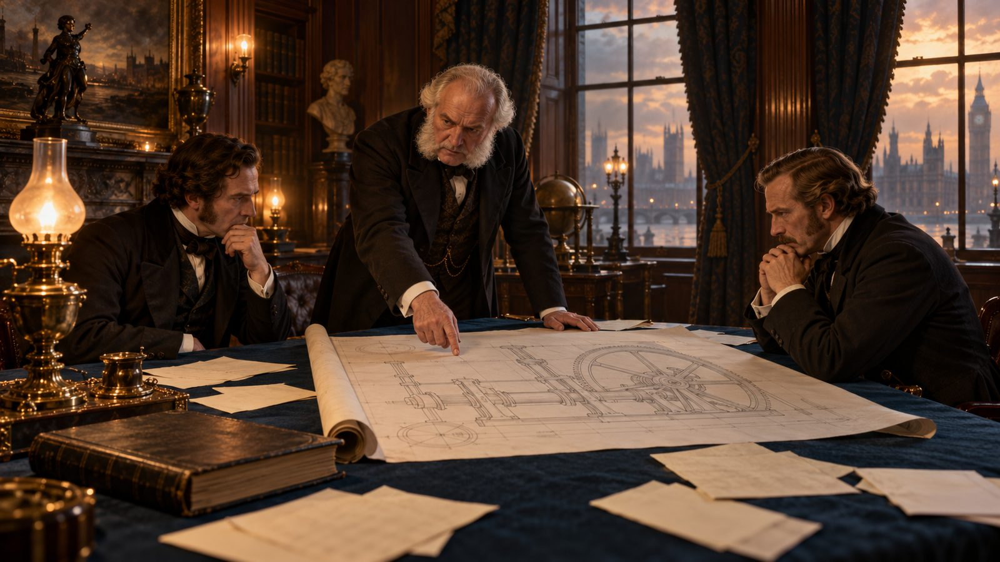
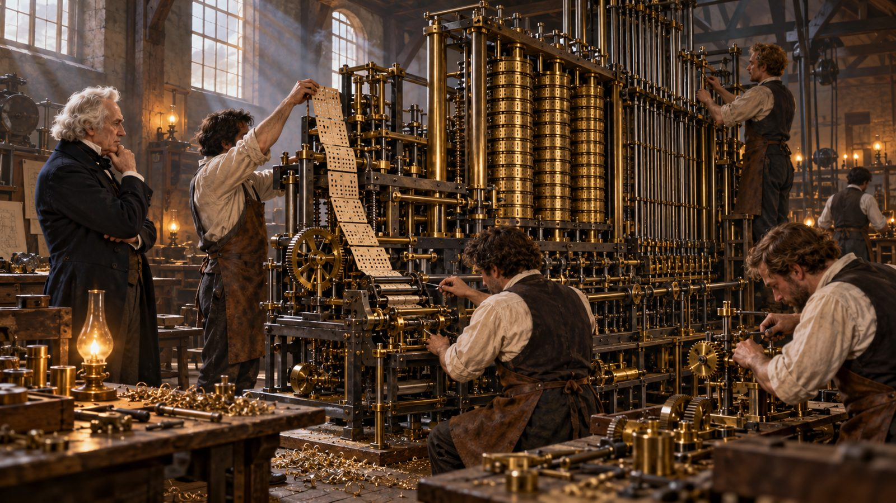
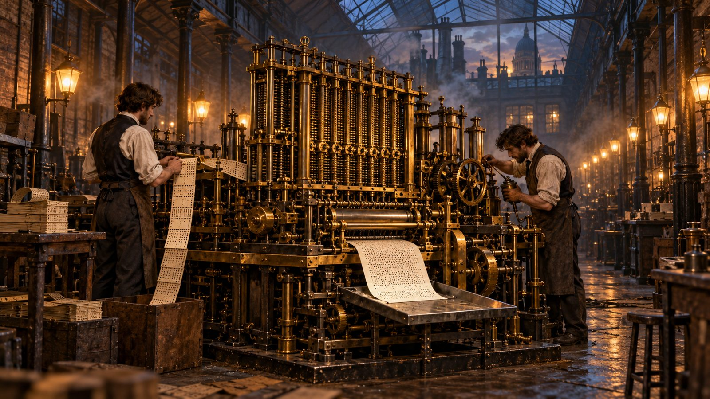
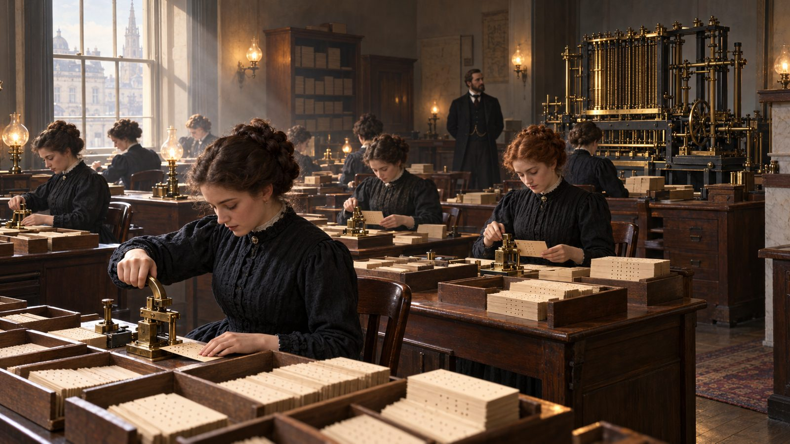
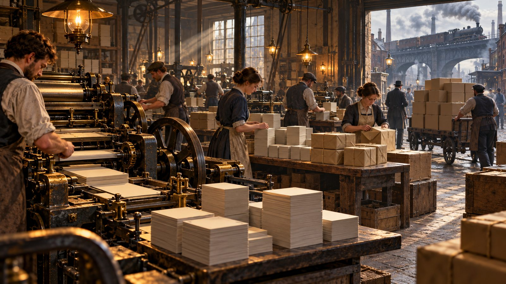
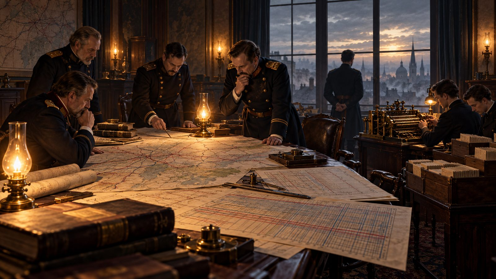
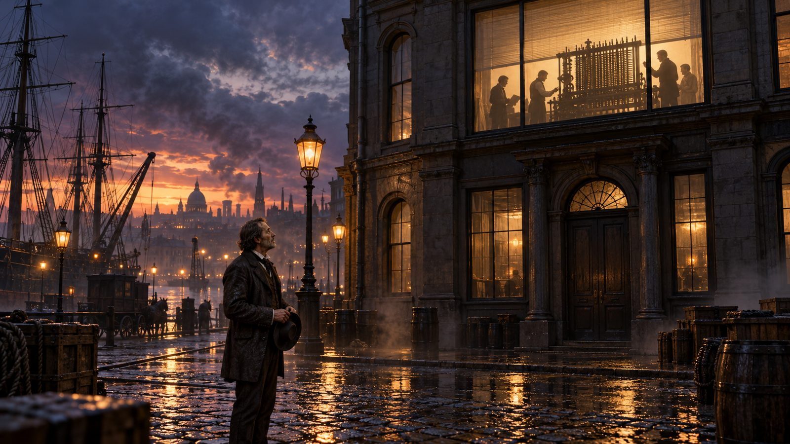
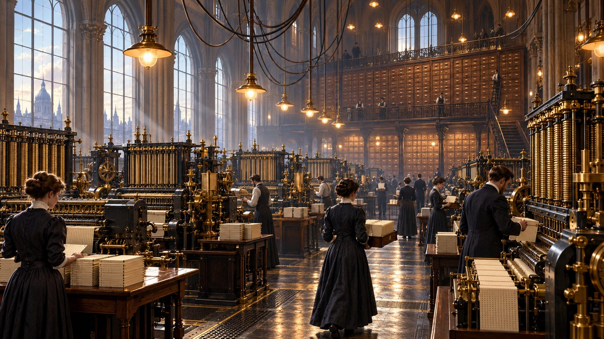

# The Analytical Century

> **What if…** What if Charles Babbage finished the Analytical Engine and programmable computing began in the 1840s instead of the 1940s?

By 1842 Charles Babbage had spent twenty years and a great deal of the Treasury's money on calculating machines. The first, the Difference Engine, sat half-built after a bitter split with his engineer. The second existed only on paper: the Analytical Engine, a programmable calculator fed by punched cards copied from the Jacquard loom, able in principle to run any sequence of operations. Ada Lovelace had just worked out how it might compute a series of numbers — the first thing we would now call a program. Then Robert Peel's government reviewed the accounts and walked away, and the design gathered dust for a hundred years. This is the timeline where the Treasury, that June, decided to keep paying.

## The vote that wasn't withdrawn

The meeting was supposed to end it. Peel had read the Astronomer Royal's verdict — the man thought the engine worthless — and the Chancellor wanted the grant closed. What changed his mind was a dull thing: a list of errors. A clerk had tallied the mistakes in the printed navigation tables the Admiralty relied on, and the figure was ugly. Ships had been lost to arithmetic. Babbage argued that a machine does not get tired at the four hundredth logarithm. Peel, who disliked the man intensely, granted two more years and a smaller sum, on the condition that the thing produce something the Navy could use. Babbage took the deal and said nothing about how little money it was.

## Brass and punched card

The workshop behind Babbage's house in Dorset Street filled with brass. Not the whole engine he had dreamed — he scaled it down to fit the grant — but a working one: columns of toothed wheels for holding numbers, a 'mill' to do the arithmetic, a reader for stiff pasteboard cards punched with holes. Lovelace, writing in a fast slanting hand, sent sequences of cards to try. In the autumn of 1846 the machine ran her routine for a table of Bernoulli numbers and printed a column of digits with no mistakes in it. Babbage was sixty-four and wept, which the workmen found embarrassing. The cards for that run were kept in a drawer afterward like relics.

## The error-free almanac

The Navy got its tables. The engine, grinding away in a rented hall off Fleet Street with two men to feed it cards and oil its gears, produced navigation and tide tables that did not need checking against a second human computer — because there was no second guess to disagree with, only the cards. The Admiralty ordered a larger one. So did the actuaries, who ran mortality tables for the insurance offices, and the railway companies, who had timetables and interest to compute. By 1854 there were nine engines in London. They were slow by any later standard, enormous, and they broke often. They were also never tired, and that turned out to be the whole point.

## The computing offices

A new kind of office appeared along the Strand: the computing bureau, where you could buy an afternoon of the engine's time the way you bought a lawyer's. Clerks learned to write in cards. The work of punching and verifying them fell often to women — careful, cheap to hire, and, the managers said, less bored by it — and the better ones became something between typist and programmer, composing the card sequences themselves. They called themselves computers, as the humans who did the sums by hand always had been. Ada Lovelace did not see much of it. She died in 1852, forty-six years old, having lived just long enough to watch her Bernoulli cards become a trade.

## Cards across the water

The design could not be kept home. Prussia built its own engines for the artillery and the statisticians; France for the state lottery and the census. In America, where counting the 1860 population by hand had nearly broken the Census Office, clerks adapted the cards to tally a nation, and the machines that followed spread into the railroads and the grain exchanges. A whole industry grew up making the cards themselves — stiff, uniform pasteboard, sold by the ten thousand — and another repairing the engines, which still broke. Punched cards became a currency of their own. You could mail a problem to a bureau in one city and have the answer back by rail the same week.

## The analytical war

The Prussians fought the French in 1870 with timetables as much as rifles. Their general staff had fed the mobilization into engines months before — which corps on which train on which morning — and the French, who owned the machines but had not formed the habit, lost the argument of schedules before the first shell. Afterward, every war ministry in Europe wanted a computing section. The engines did not make the fighting less terrible; the dead at Sedan were as dead as any. What they changed was the character of command, which became, in part, a problem of cards. A general now lost or won partly in a quiet room full of clerks he would never meet.

## The clerk replaced

For the men who had made their living as human computers — the bank clerks who totted ledgers, the surveyors' assistants, the almanac calculators — the engines were not a wonder but a notice. A single machine with four attendants did the arithmetic of forty men, and did it through the night. There were protests; a card-punchers' union formed in Manchester in 1878 and struck over piece rates. Some of the displaced learned the cards and moved up; more did not. A clerk named Thomas Aldridge, laid off from a Liverpool shipping office in 1881, wrote in his diary that he had been beaten not by a cleverer man but by a thing that could not read what it printed. The complaint was common and did no good.

## A century arrives early

By 1900 the engines had been running for half a century, and the world had arranged itself around them a lifetime ahead of schedule. States knew their populations in detail and taxed accordingly. Insurance and shipping ran on computed risk. Codebreakers in three empires raced each other through intercepted telegrams by machine. The engines were electric now, faster, still fed by cards, and nobody under forty remembered doing it any other way. The gains were real and so was the cost: surveillance came early, and so did the habit of trusting a number because a machine had printed it. Babbage had died in 1871, honoured at last, having built the nineteenth century a tool it was not quite ready to be handed.

