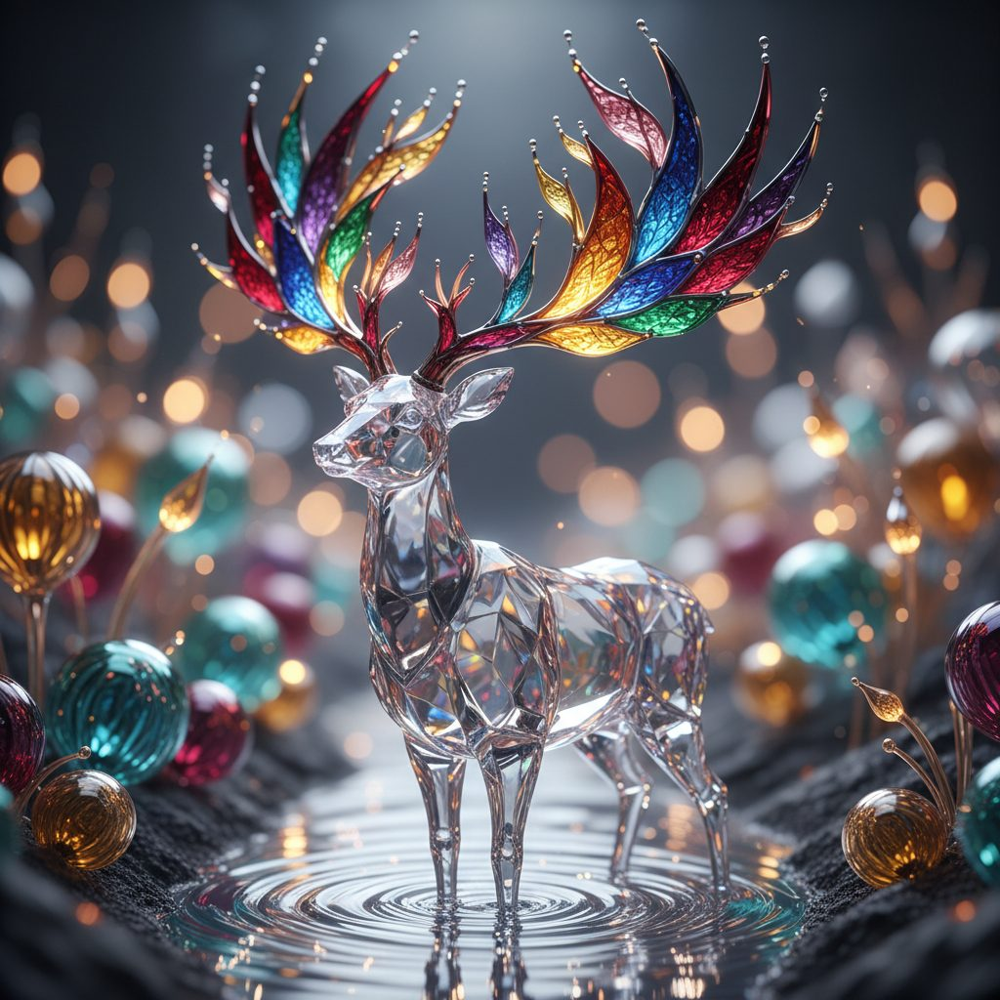

# Crystalline Fauna

**Pack:** [Stained Glass Biomes](./stained-glass-biomes.md)

### Prompt
> A stunning macro shot of a majestic stag whose body is made of polished, clear crystal and whose antlers are an intricate lattice of vibrant, multicolored stained glass. The stag stands in a shallow stream of liquid silver, its form refracting the ambient light into countless tiny rainbows. The background is a soft-focus bokeh of glowing glass flora. Photorealistic, shallow depth of field, detailed filigree, subsurface scattering, glowing core.

- **Negative Prompt:** cartoon animal, opaque body, simple glass, feathers or fur, plain background, blurry details
- **Aspect Ratio:** 1:1
- **Style Tags:** creature design, macro photography, photorealistic, subsurface scattering, refractive, fantasy
- **Use Case:** Designing a unique fantasy creature for concept art, a character portrait, or a decorative piece.
