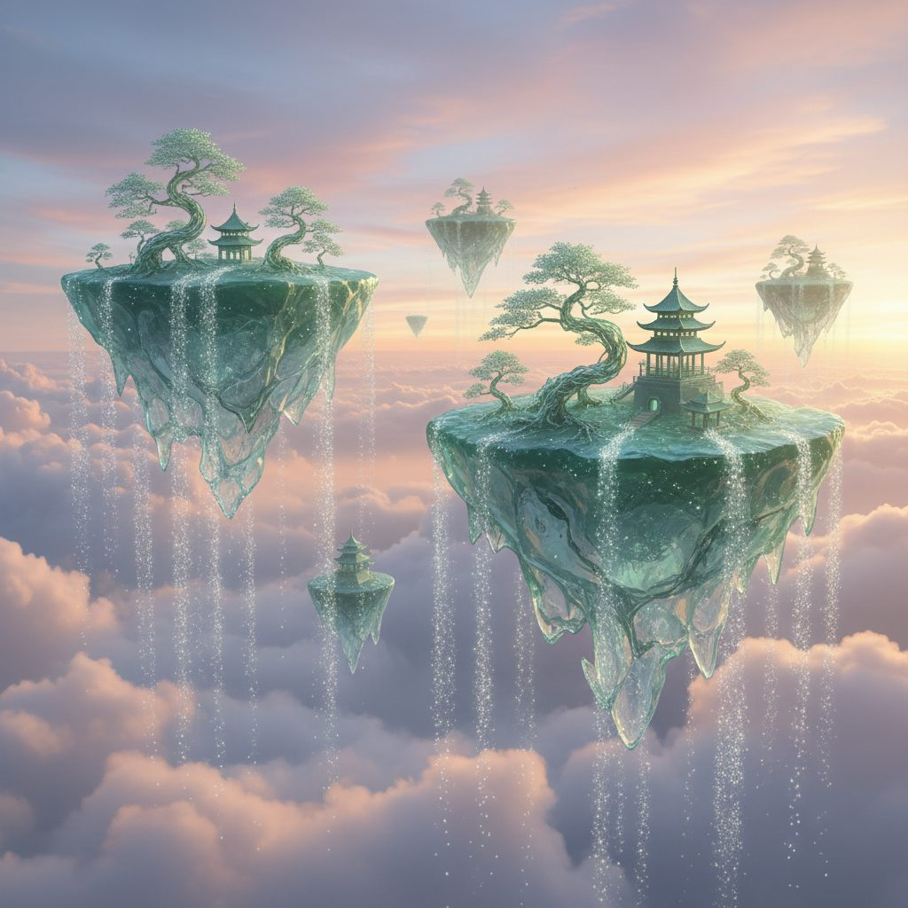

# Floating Glass Islets

**Pack:** [Stained Glass Biomes](./stained-glass-biomes.md)

### Prompt
> A serene skyscape featuring massive floating islands made of solid, sea-green glass, drifting through a soft, cloud-filled sky at sunset. Each island has delicate, filigree-like structures on its surface resembling bonsai trees and pagodas, all crafted from finer strands of glass. Waterfalls of sparkling, crystalline dust pour from the edges of the islands. Ethereal, dreamlike, grand scale, fantasy art, volumetric clouds, pastel color palette.

- **Negative Prompt:** rock, soil, green trees, harsh lighting, ground level view, dark colors
- **Aspect Ratio:** 16:9
- **Style Tags:** ethereal, floating islands, dreamlike, pastel, serene, Studio Ghibli inspired
- **Use Case:** Illustrating a peaceful and beautiful dream world, a high-fantasy concept, or a visually stunning background.
