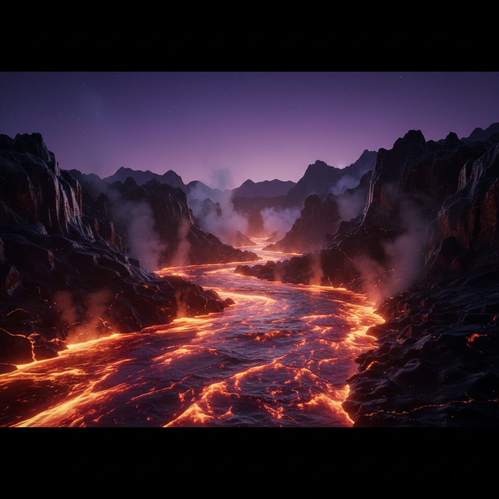

# Molten Glass River at Dusk

**Pack:** [Stained Glass Biomes](./stained-glass-biomes.md)

### Prompt
> A wide, cinematic shot of a river of molten glass glowing with intense internal heat, flowing through a dark, jagged landscape of obsidian cliffs. The sky is a deep twilight purple, and the only light source is the river itself, casting a fiery orange and red glow on the polished black rock. Wisps of steam and shimmering heat haze rise from the river's surface. Dynamic composition, high contrast, glowing, fluid simulation, atmospheric, epic scale.

- **Negative Prompt:** water, mud, dirt, daylight, static image, cool colors, unrealistic flow
- **Aspect Ratio:** 16:9
- **Style Tags:** luminous, molten, glowing, dynamic, high contrast, cinematic
- **Use Case:** Designing a dramatic and hazardous environment for a game world or an epic fantasy illustration.
