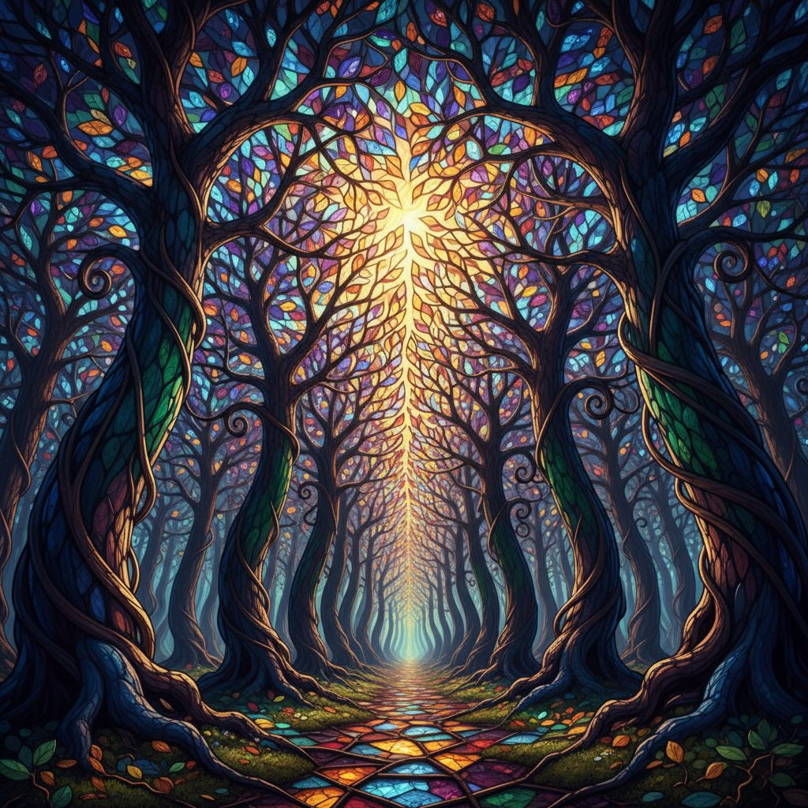

# Prismatic Canopy Forest

**Pack:** [Stained Glass Biomes](./stained-glass-biomes.md)

### Prompt
> A view from the forest floor looking up through a dense canopy of stained glass trees. The trunks are thick, twisted columns of deep cobalt and emerald glass, with branches of soldered metalwork. Leaves are sharp, translucent shards of amethyst and amber. Sunlight filters through the canopy, projecting a complex, ever-shifting mosaic of brilliant colors onto the ground below. Style of Art Nouveau, hyperrealistic, caustics, volumetric lighting, sharp focus, octane render.

- **Negative Prompt:** dull colors, plastic texture, blurry, opaque leaves, cartoonish, simple shapes
- **Aspect Ratio:** 4:5
- **Style Tags:** fantasy, stained glass, iridescent, kaleidoscopic, Art Nouveau, volumetric lighting
- **Use Case:** Creating a magical, immersive background for fantasy art, a book cover, or a unique phone wallpaper.
