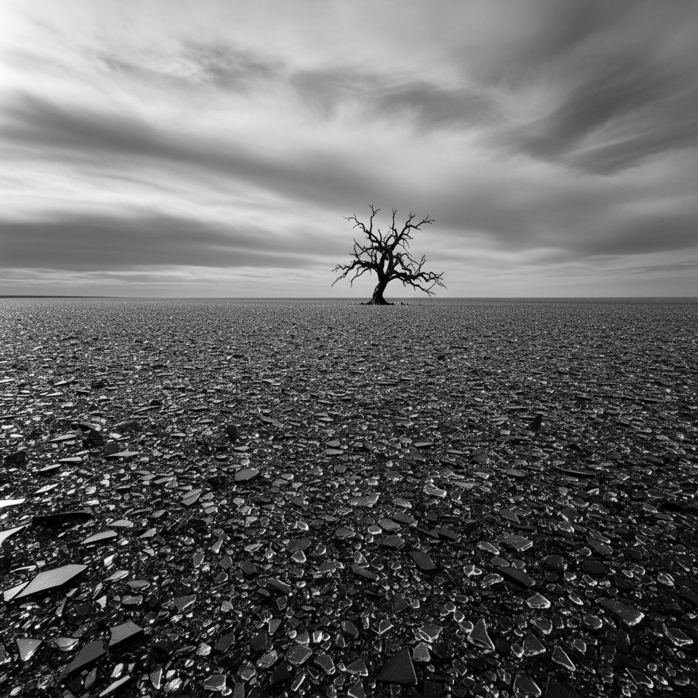

# Shattered Plains

**Pack:** [Stained Glass Biomes](./stained-glass-biomes.md)

### Prompt
> A desolate and beautiful landscape of a vast plain covered in shattered, sharp-edged fragments of dark colored glass under a moody, overcast sky. The ground glitters with millions of tiny, sharp points of reflected light. A lone, twisted tree made of dark, leaded glass stands silhouetted against the horizon. Somber atmosphere, post-apocalyptic feel, sharp details, cinematic, Ansel Adams style composition.

- **Negative Prompt:** smooth surfaces, sand, dirt, vegetation, warm colors, people, sunny day
- **Aspect Ratio:** 16:9
- **Style Tags:** desolate, sharp, monochromatic, atmospheric, cinematic, minimalist
- **Use Case:** Establishing a somber, dangerous, or post-apocalyptic mood for a scene or background.
