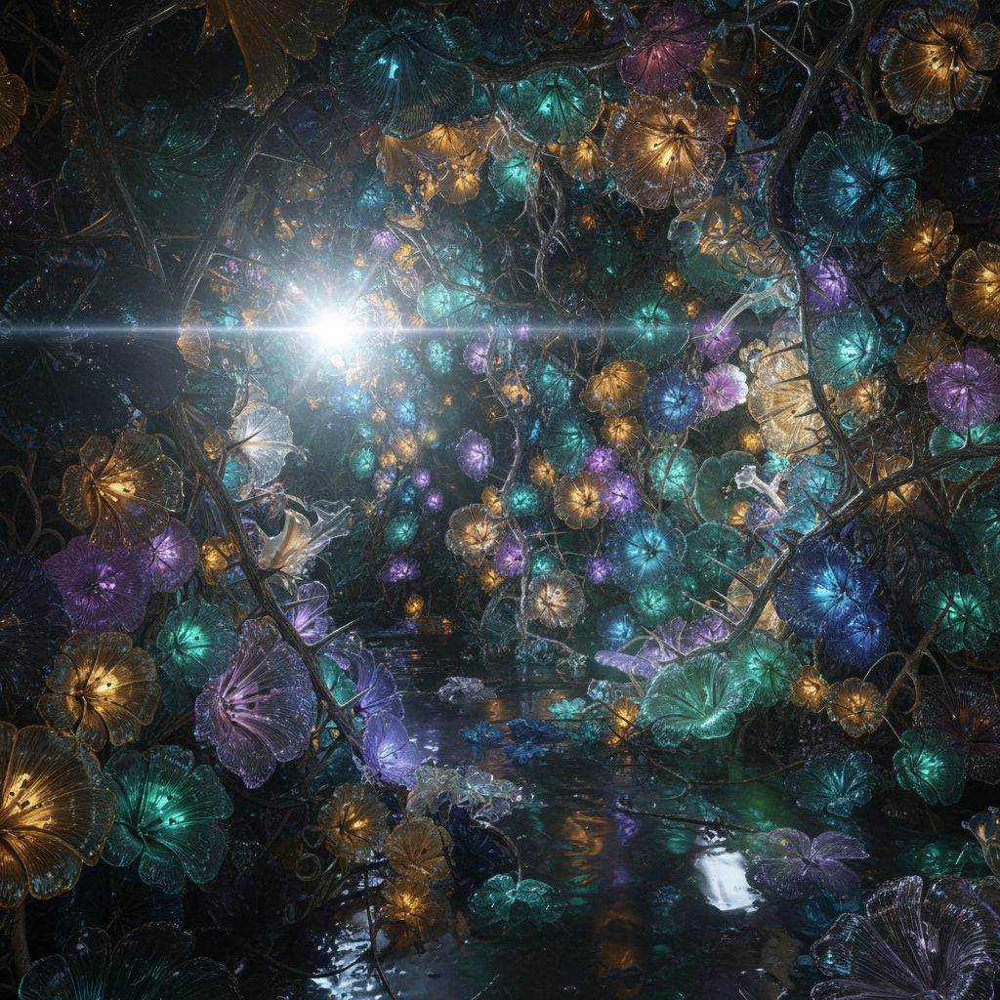

# The Glassblower's Grotto

**Pack:** [Stained Glass Biomes](./stained-glass-biomes.md)

### Prompt
> An interior shot of a hidden, mystical grotto where the walls themselves are alive with blooming glass flowers. Delicate, translucent flowers with paper-thin petals grow in clusters, each glowing softly with a different internal light. Intricate, crystalline vines with sharp glass thorns climb the walls. A powerful sense of magic and natural, untamed creation. Detailed macro, ethereal lighting, strong caustics, lens flare, magical realism.

- **Negative Prompt:** human figures, tools, fire, artificial structures, dull lighting, symmetry
- **Aspect Ratio:** 4:5
- **Style Tags:** grotto, caustics, lens flare, glowing, bioluminescent, macro detail
- **Use Case:** Creating a mystical and mysterious interior environment, a secret location in a story, or a beautiful art piece.
