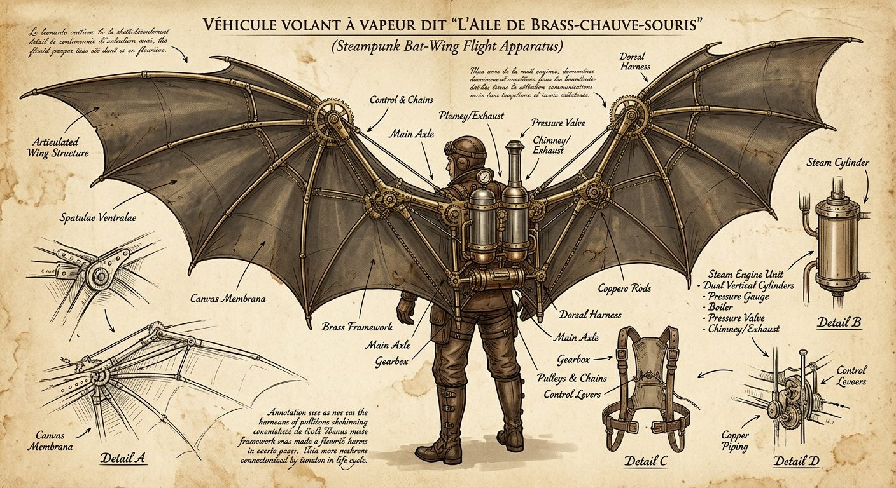

# Aether-Wing Jetpack Blueprint

**Pack:** [Steampunk Contraptions](./steampunk-contraptions.md)

### Prompt
> A schematic-style illustration of a wearable steampunk flight apparatus. The contraption features articulated canvas bat-wings stretched over an intricate skeleton of lightweight brass tubing, powered by a small dual-cylinder steam engine backpack. Vintage blueprint aesthetic, sepia tones, annotated with faux Victorian script, Leonardo da Vinci sketchbook style, ink and parchment.

- **Negative Prompt:** photorealistic, modern jetpack, jet engines, colorful, modern text, 3d render, digital UI.
- **Aspect Ratio:** 1:1
- **Style Tags:** blueprint, sketch, vintage, invention, steampunk
- **Use Case:** In-universe lore documents, game UI elements, or vintage art prints.
