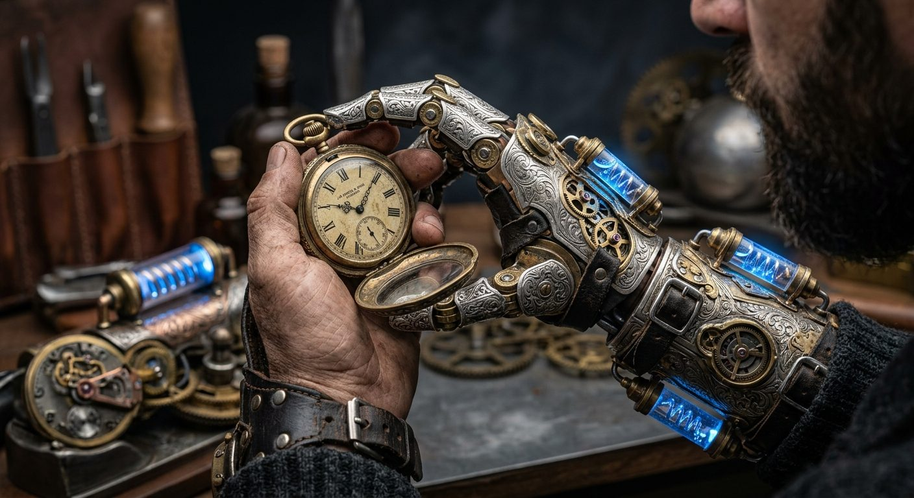

# Artisan's Clockwork Arm

**Pack:** [Steampunk Contraptions](./steampunk-contraptions.md)

### Prompt
> Extreme close-up of a human wearing a highly ornate steampunk prosthetic arm. The mechanical limb features beautifully engraved silver plating, delicate watchmaker gears, dark leather straps, and glowing blue aether-vials powering the joints. The mechanical hand is delicately holding an antique pocket watch. Studio lighting, sharp focus, 8k resolution, exceptionally detailed textures.

- **Negative Prompt:** cyberpunk, futuristic cyborg, chrome, robotics, modern medical prosthetic, gory, bloody, plastic.
- **Aspect Ratio:** 1:1
- **Style Tags:** prosthetic, close-up, ornate, steampunk, high-fantasy
- **Use Case:** Detailed character reference and item design for cosplay or 3D modeling.
