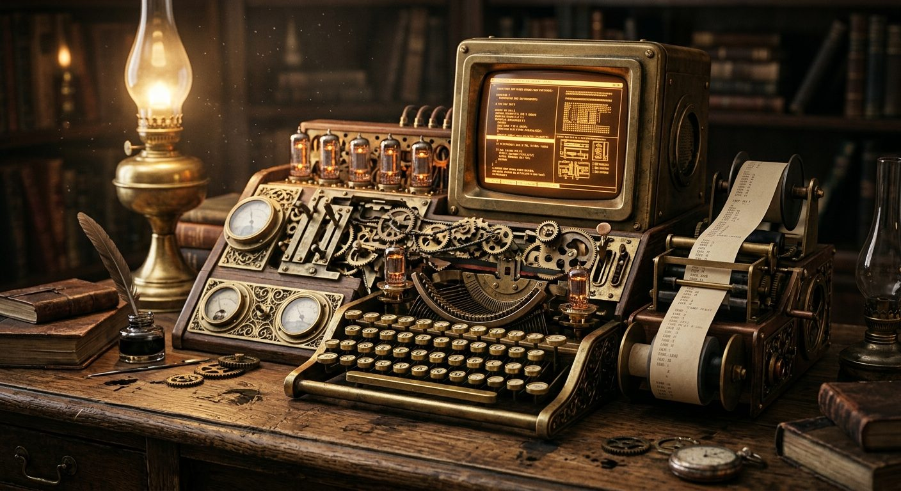

# Brass Analytical Engine

**Pack:** [Steampunk Contraptions](./steampunk-contraptions.md)

### Prompt
> An elaborately crafted steampunk computer workstation sitting on a heavy oak desk in a dimly lit scholar's study. Features a brass typewriter keyboard, a matrix of clicking gears, glowing vacuum tubes, and a complex array of mechanical dials and paper ticker tape. Dust motes floating in the light of a nearby gas lamp, macro photography, shallow depth of field, hyper-detailed textures.

- **Negative Prompt:** LCD screens, glowing LEDs, modern keyboard, plastic, sleek, minimalist, monitors.
- **Aspect Ratio:** 3:2
- **Style Tags:** macro, machinery, steampunk, still life, intricate
- **Use Case:** Prop design and atmospheric world-building illustrations.
