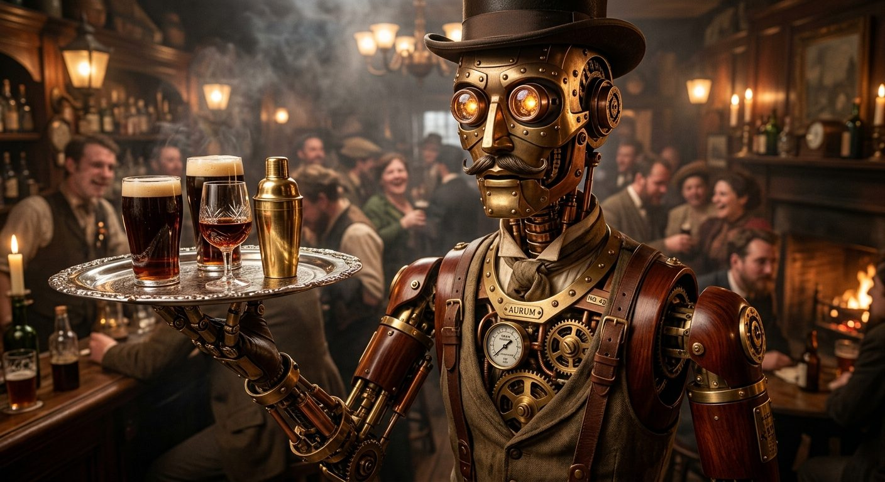

# Clockwork Automaton Waiter

**Pack:** [Steampunk Contraptions](./steampunk-contraptions.md)

### Prompt
> Close-up portrait of an intricate steampunk automaton functioning as a waiter in a smoky Victorian tavern. The robot features a polished mahogany chassis, exposed gleaming brass gears, copper pistons, and glowing crystal lenses for eyes. It is holding a silver tray with crystal glasses. Rich warm ambient lighting, highly detailed mechanical joints, photorealistic, Unreal Engine 5 render style.

- **Negative Prompt:** modern, futuristic, plastic, glowing neon, lasers, low resolution, blurry, distorted proportions, cyberpunk.
- **Aspect Ratio:** 4:5
- **Style Tags:** steampunk, automaton, photorealistic, Victorian, brass
- **Use Case:** Character concept art for a steampunk RPG or visual novel.
