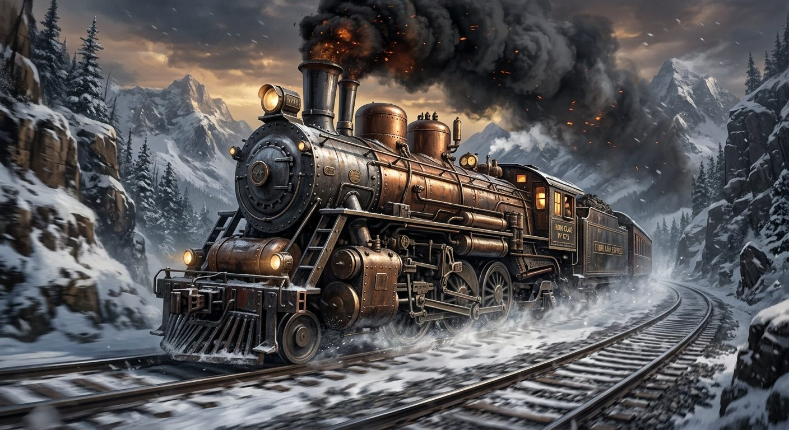

# Leviathan Steam Locomotive

**Pack:** [Steampunk Contraptions](./steampunk-contraptions.md)

### Prompt
> A massive, heavily armored steampunk train barreling through a snowy mountain pass. The locomotive is a beast of riveted iron, oversized copper boilers, and towering smokestacks billowing thick black smoke and glowing embers. Dynamic angle from below, motion blur on the tracks, dramatic cinematic lighting, industrial revolution aesthetic, highly detailed digital painting.

- **Negative Prompt:** modern train, bullet train, diesel, peaceful, static, cartoon, cell-shaded, contemporary.
- **Aspect Ratio:** 16:9
- **Style Tags:** locomotive, industrial, dynamic, concept art, steampunk
- **Use Case:** Environment and vehicle design for action sequences in games or books.
