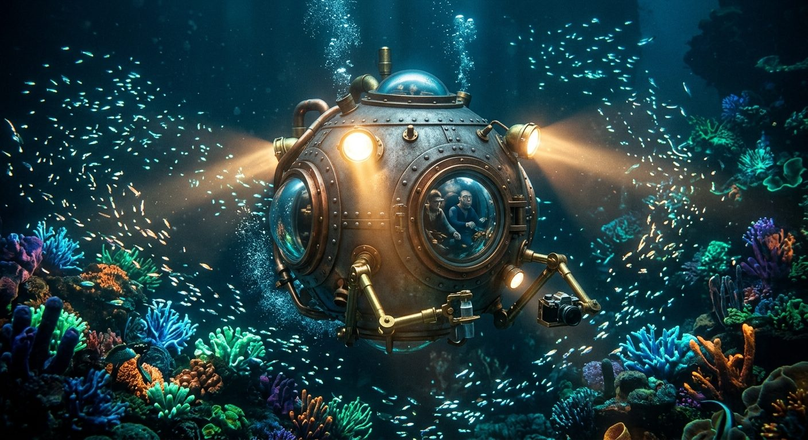

# Nautilus Exploration Pod

**Pack:** [Steampunk Contraptions](./steampunk-contraptions.md)

### Prompt
> A spherical steampunk bathysphere submerged deep underwater, exploring a glowing coral reef. The vessel is constructed of riveted heavy iron plates, thick domed glass windows, and exterior brass manipulator arms. Illuminated by large external arc lamps casting bright beams through the murky blue water. Schools of bioluminescent fish surrounding it. Cinematic underwater photography, volumetric light rays.

- **Negative Prompt:** modern submarine, sleek, yellow submarine, sci-fi spaceship, dry, low detail, modern diving gear.
- **Aspect Ratio:** 16:9
- **Style Tags:** underwater, vehicle, cinematic, exploration, steampunk
- **Use Case:** Environmental concept art and storytelling backgrounds.
