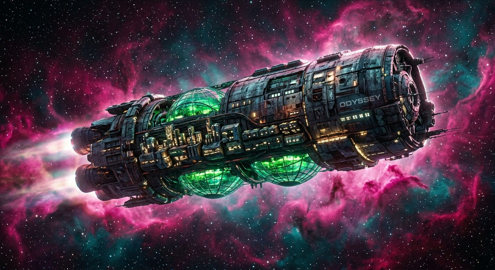

# Nomadic Generation Ship

**Pack:** [Deep Space Megastructures](./deep-space-megastructures.md)

### Prompt
> A massive cylindrical generation ship drifting silently through a vibrant magenta and teal nebula. The hull is heavily scarred and patched with glowing brutalist architecture and sprawling hydroponic biodomes emitting a bioluminescent green light. Volumetric nebula gas parting around the ship's massive fusion exhaust, dramatic rim lighting, highly detailed surface texture, cinematic deep space photography.

- **Negative Prompt:** stars only, empty space, cartoon, cel-shaded, weapons, lasers, combat, clean, pristine.
- **Aspect Ratio:** 21:9
- **Style Tags:** deep space photography, brutalist sci-fi, nebula, generation ship, cinematic lighting
- **Use Case:** Cover art for a space opera novel or sci-fi ambient music mix on YouTube.
