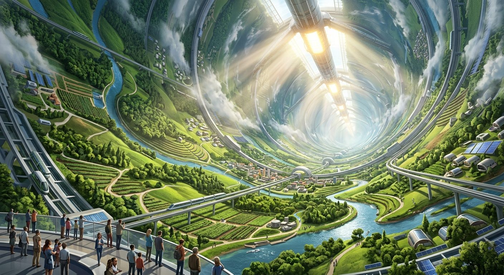

# Orbital Ring Agriculture

**Pack:** [Deep Space Megastructures](./deep-space-megastructures.md)

### Prompt
> A breathtaking view from inside a vast, rotating orbital ring habitat. Rolling green hills, agricultural terraces, and artificial rivers curve infinitely upward into the sky, eventually becoming the ceiling. Giant atmospheric scrubbers and artificial sun pylons run down the center axis. Crisp, bright, utopian sci-fi aesthetic, photorealistic, architectural rendering, volumetric sunlight rays, solarpunk influences.

- **Negative Prompt:** dark, dystopia, grime, dirty, apocalyptic, flat horizon, exterior view, claustrophobic.
- **Aspect Ratio:** 4:5
- **Style Tags:** solarpunk, utopian sci-fi, orbital habitat, architectural render, photorealistic
- **Use Case:** Vertical scroll artwork for mobile articles or optimistic sci-fi editorial illustrations.
