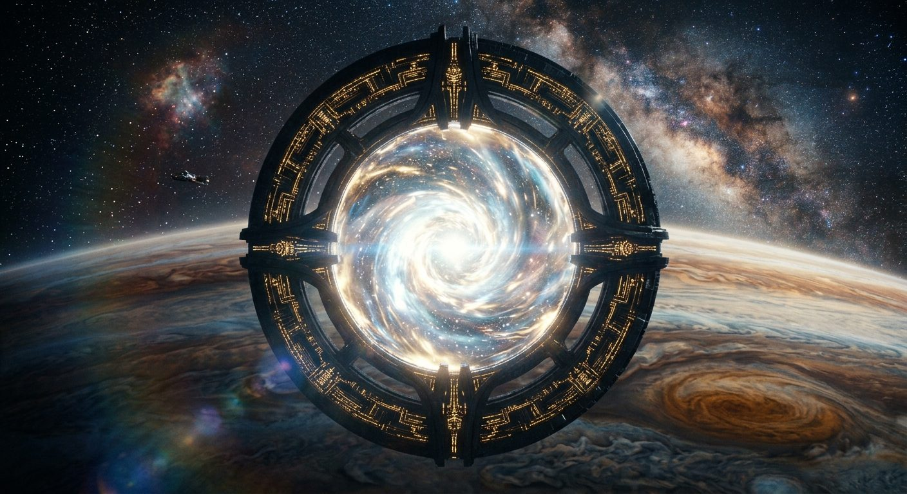

# Quantum Jump Gate

**Pack:** [Deep Space Megastructures](./deep-space-megastructures.md)

### Prompt
> A monolithic, circular quantum jump gate suspended above the swirling clouds of a gas giant. The gate's inner ring is activating, creating a blindingly bright, distortion-heavy event horizon that bends the starlight around it. Symmetrical, monumental alien design, smooth obsidian-like materials with glowing gold circuitry patterns, lens flares, interstellar travel, IMAX movie still quality.

- **Negative Prompt:** terrestrial, small scale, human, text, watermarks, asymmetrical, rough textures, low quality.
- **Aspect Ratio:** 1:1
- **Style Tags:** alien technology, event horizon, monumental scale, IMAX still, symmetric
- **Use Case:** Album cover for a synthwave or spacewave artist, or a profile avatar for a sci-fi community.
