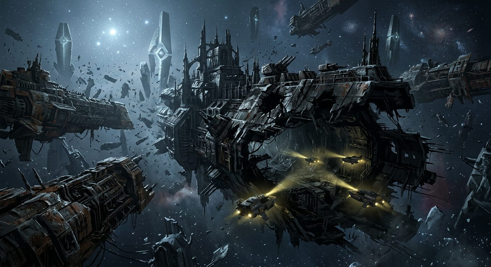

# Ship Graveyard at the Edge

**Pack:** [Deep Space Megastructures](./deep-space-megastructures.md)

### Prompt
> A haunting expanse of zero-gravity space filled with the colossal rusting hulks of derelict dreadnoughts and ancient alien monoliths. Cold, pale starlight casts long, harsh shadows across jagged metal bulkheads. Tiny scavenger skiffs with bright yellow spotlights probe the dark, cavernous hangars of a dead flagship. Eerie, atmospheric, gothic sci-fi aesthetic, matte painting, hyper-detailed.

- **Negative Prompt:** bright, colorful, clean, new, fast motion, action, explosions, lasers, living crew.
- **Aspect Ratio:** 16:9
- **Style Tags:** gothic sci-fi, matte painting, atmospheric, derelict ships, creepy space
- **Use Case:** Environmental mood board for a sci-fi horror game or cinematic storyboard.
