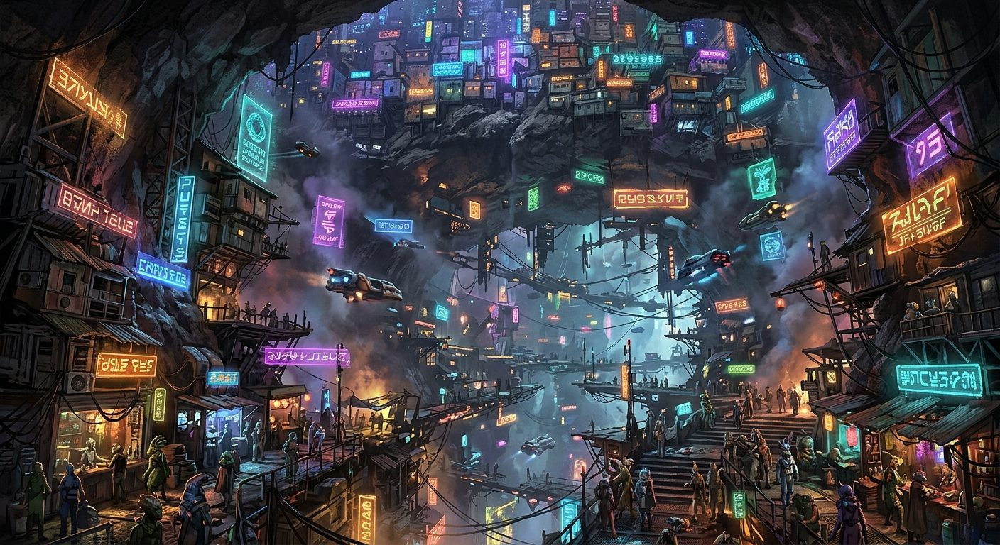

# The Asteroid Bazaar

**Pack:** [Deep Space Megastructures](./deep-space-megastructures.md)

### Prompt
> Interior of a hollowed-out gargantuan asteroid functioning as a neon-lit interstellar trading hub. Elaborate suspended platforms, glowing holographic advertisements in alien languages, and dense, multi-tiered shantytowns clinging to the cavernous rocky ceiling. A vibrant, bustling atmosphere bathed in volumetric haze and neon cyan and orange lights, cyberpunk aesthetics mixed with gritty space realism, digital painting.

- **Negative Prompt:** outdoor, planet surface, clean, sterile, minimal, low detail, depth of field blur, natural sunlight.
- **Aspect Ratio:** 16:9
- **Style Tags:** cyberpunk, space market, gritty realism, holographic neon, concept art
- **Use Case:** Concept art for a tabletop RPG setting or world-building reference for writers.
