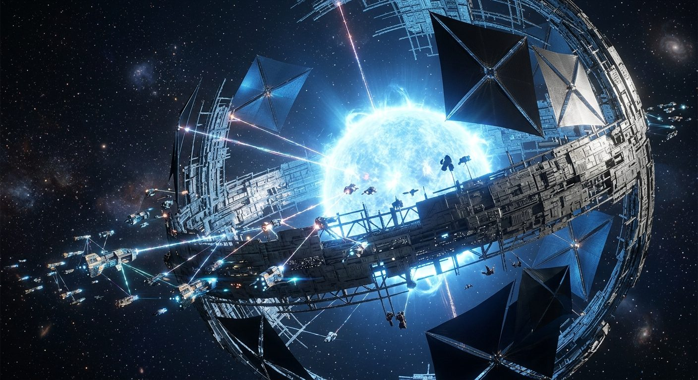

# The Dyson Sphere Forge

**Pack:** [Deep Space Megastructures](./deep-space-megastructures.md)

### Prompt
> A colossal, partially completed Dyson Sphere surrounding a hyperactive blue giant star. Swarms of geometric constructor ships tethered by brilliant laser cables weave intricate metallic lattices. Cinematic lighting, extreme scale contrast, high-tech greebling, solar flares illuminating carbon-black solar sails, 8k resolution, unreal engine 5 render, hard sci-fi concept art.

- **Negative Prompt:** planet, terrain, organic, soft edges, blurry, low resolution, amateur, steampunk, retro sci-fi.
- **Aspect Ratio:** 16:9
- **Style Tags:** sci-fi concept art, megastructure, hard sci-fi, space engineering, epic scale
- **Use Case:** Epic background art for a sci-fi video game menu or cinematic establishing shot.
