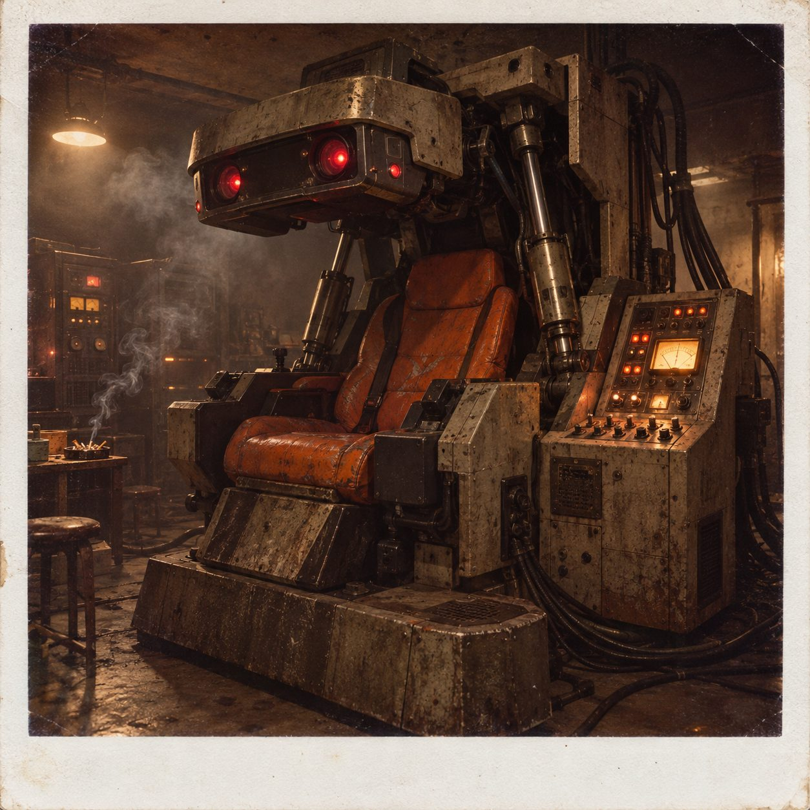

# Brutalist VR Arcade Pod

**Pack:** [Cassette Futurism & Analog Cyberpunk](./cassette-futurism-analog-cyberpunk.md)

### Prompt
> A massive, brutalist-style virtual reality arcade machine in a dark, hazy, underground room. The machine features a faded orange leather bucket seat, heavy exposed hydraulic pistons, and a drop-down chunky metallic visor with glowing red optical sensors. Stale cigarette smoke hangs in the air, illuminated by the harsh, flickering glow of the machine's analog control panel. Polaroid style, vintage 1970s film aesthetic, gritty, moody atmosphere.

- **Negative Prompt:** modern VR, oculus, clean room, bright lighting, flat design, modern gaming, cheerful
- **Aspect Ratio:** 1:1
- **Style Tags:** Vintage 70s, Brutalism, Gritty, Film Photography, Polaroid Aesthetic
- **Use Case:** Album cover art for synthwave or industrial music tracks.
