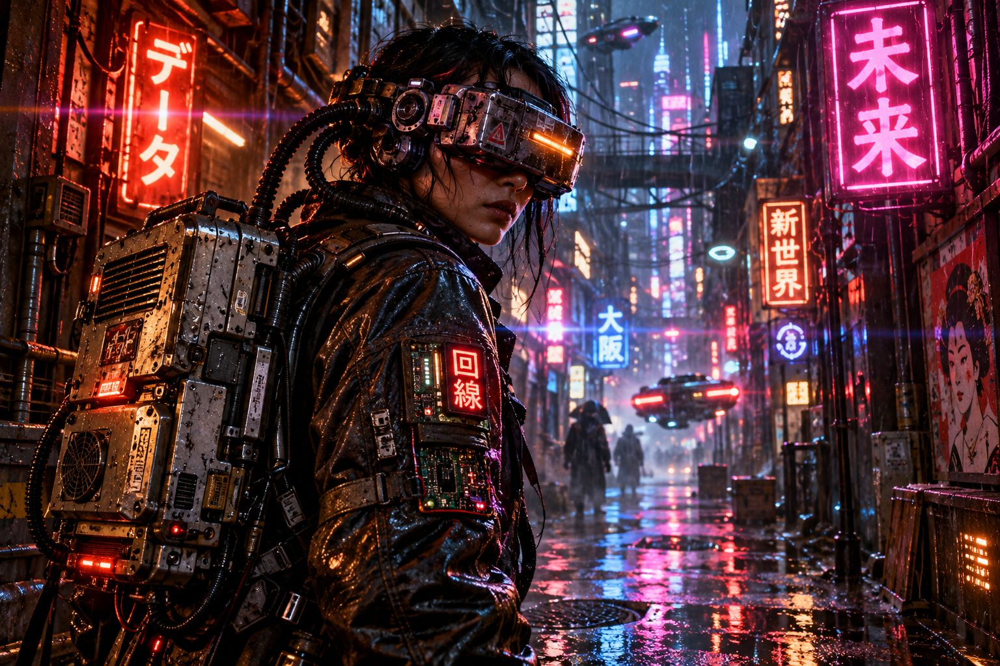

# Hardwired Data Courier

**Pack:** [Cassette Futurism & Analog Cyberpunk](./cassette-futurism-analog-cyberpunk.md)

### Prompt
> A cyberpunk data runner standing in a rain-slicked, neon-lit alleyway. They are wearing a bulky, metallic augmented reality visor connected by thick coiled cables to a heavy, vented metal backpack. Their jacket is made of worn leather with glowing LED patches and exposed circuit boards. Bright neon kanji signs reflect in the oily puddles on the ground. Cinematic night photography, neon noir, anamorphic lens flare, high contrast, rainy atmosphere.

- **Negative Prompt:** daylight, clean, modern clothing, wireless tech, sunny, plain background, low detail
- **Aspect Ratio:** 16:9
- **Style Tags:** Neon Noir, Street Photography, Atmospheric, Cyberpunk, Cinematic
- **Use Case:** Establishing character mood boards or creating immersive environment illustrations.
