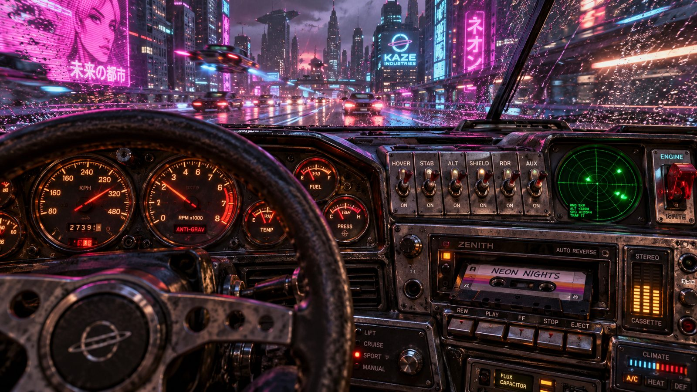

# Hover-Car Analog Dashboard

**Pack:** [Cassette Futurism & Analog Cyberpunk](./cassette-futurism-analog-cyberpunk.md)

### Prompt
> Interior POV from the driver's seat of a retro-futuristic hover-car. The dashboard is a chaotic, highly detailed mix of analog dials, physical steel toggle switches, an integrated cassette player with a mixtape half-inserted, and a tiny circular radar screen plotting green dots. Through the rain-splattered windshield, a blurry, neon-lit dystopian cityscape whizzes by at high speed. Shallow depth of field focusing strictly on the tactile dashboard, synthwave color palette, moody lighting.

- **Negative Prompt:** modern car interior, tesla, touchscreens, daylight, plain steering wheel, deep depth of field
- **Aspect Ratio:** 16:9
- **Style Tags:** POV, Synthwave, Depth of Field, Automotive Design, Nostalgic
- **Use Case:** Creating dynamic, immersive cockpit views for gaming or UI background design.
