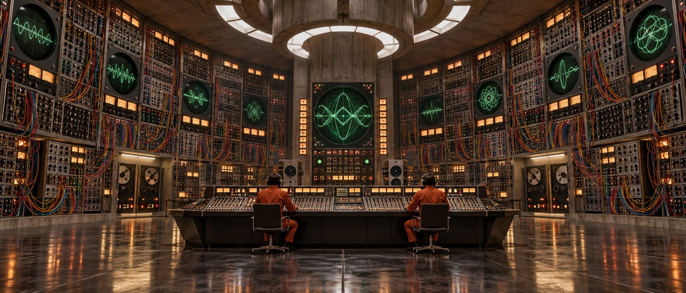

# Subterranean Synth Bunker

**Pack:** [Cassette Futurism & Analog Cyberpunk](./cassette-futurism-analog-cyberpunk.md)

### Prompt
> Wide architectural shot of a massive underground control room. The curved walls are entirely lined with floor-to-ceiling modular synthesizer banks, tangled colorful patch cables, glowing analog VU meters, and circular oscilloscope screens displaying complex green waveforms. Two operators in retro orange jumpsuits sit at a massive mixing console in the center. Cinematic lighting, highly symmetrical composition, 70s sci-fi film set style, Kubrick-esque.

- **Negative Prompt:** digital displays, modern monitors, messy composition, fantasy, daylight, small room
- **Aspect Ratio:** 16:9
- **Style Tags:** Architectural, Symmetrical, Sci-Fi Film Set, Retro Tech, Grand Scale
- **Use Case:** Background illustrations for visual novels or cinematic establishing shots.
