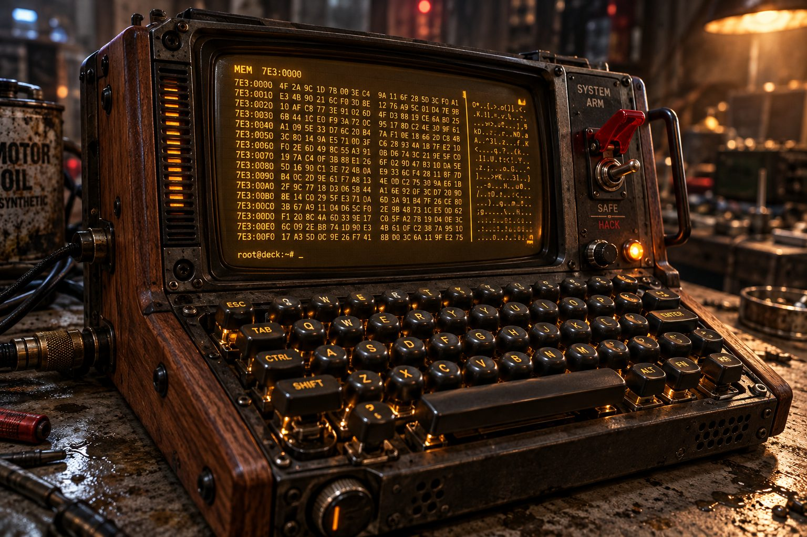

# The Custom Cyber-Deck

**Pack:** [Cassette Futurism & Analog Cyberpunk](./cassette-futurism-analog-cyberpunk.md)

### Prompt
> Close-up macro photography of a custom-built cyberdeck resting on a grimy, oil-stained concrete table. The portable hacking console features dark walnut wood side-paneling, heavy spherical mechanical keyboard switches, a glowing amber monochrome CRT display showing hexadecimal data, and a prominent red safety toggle switch. Shallow depth of field, volumetric lighting, gritty cyberpunk aesthetic, hyper-detailed textures, highly tactile.

- **Negative Prompt:** sleek, modern, touchscreen, flat, wireless, minimalist, clean, Apple design, LCD screen
- **Aspect Ratio:** 16:9
- **Style Tags:** Macro Photography, Cyberpunk, Hyper-detailed, Tactile, Industrial Design
- **Use Case:** Creating prop designs or item assets for a tabletop RPG or sci-fi video game.
