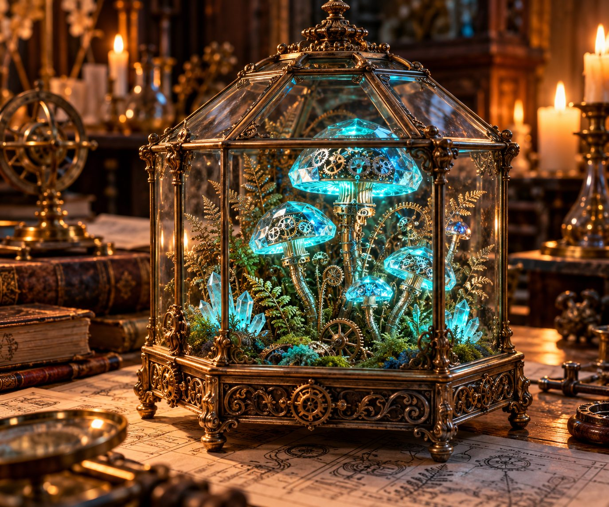

# The Alchemist's Terrarium

**Pack:** [Bioluminescent Clockwork Botany](./bioluminescent-clockwork-botany.md)

### Prompt
> An ornate Victorian glass terrarium resting on a wooden desk scattered with blueprints. Inside the terrarium, a miniature ecosystem of clockwork ferns and glowing cyan crystal mushrooms thrives. Delicate silver gears spin within the mushroom caps. Warm candlelit ambient lighting, macro photography, hyper-realistic textures, ray tracing.

- **Negative Prompt:** outdoors, messy, noisy, low detail, human figures, daylight, cartoonish
- **Aspect Ratio:** 4:5
- **Style Tags:** Macro Photography, Victorian Steampunk, Hyper-realistic, Still Life
- **Use Case:** Book cover illustration for a fantasy or steampunk novel.
