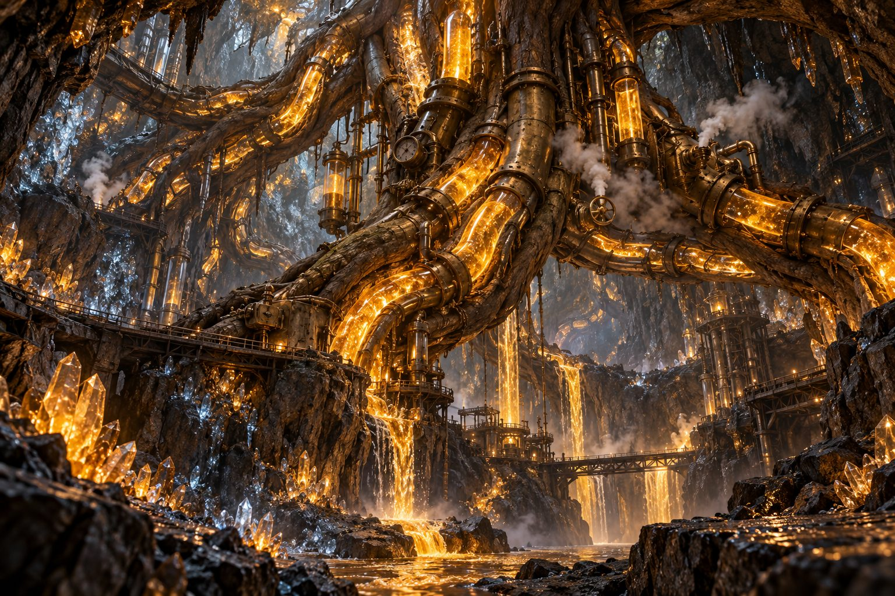

# The Subterranean Brass Root System

**Pack:** [Bioluminescent Clockwork Botany](./bioluminescent-clockwork-botany.md)

### Prompt
> An underground cavern illuminated by the glowing amber sap pumping through thick, brass-plated mechanical tree roots breaking through the ceiling. Steampunk pressure valves, steam venting from the roots, and sparkling mineral deposits on the cave walls. Subsurface scattering on the sap, industrial fantasy environment, Octane render.

- **Negative Prompt:** sky, clouds, natural wood, sunlight, flat shading, low poly, plain background
- **Aspect Ratio:** 16:9
- **Style Tags:** Industrial Fantasy, Underground, 3D Render, Steampunk
- **Use Case:** Level design reference or visual aid for a tabletop RPG campaign.
