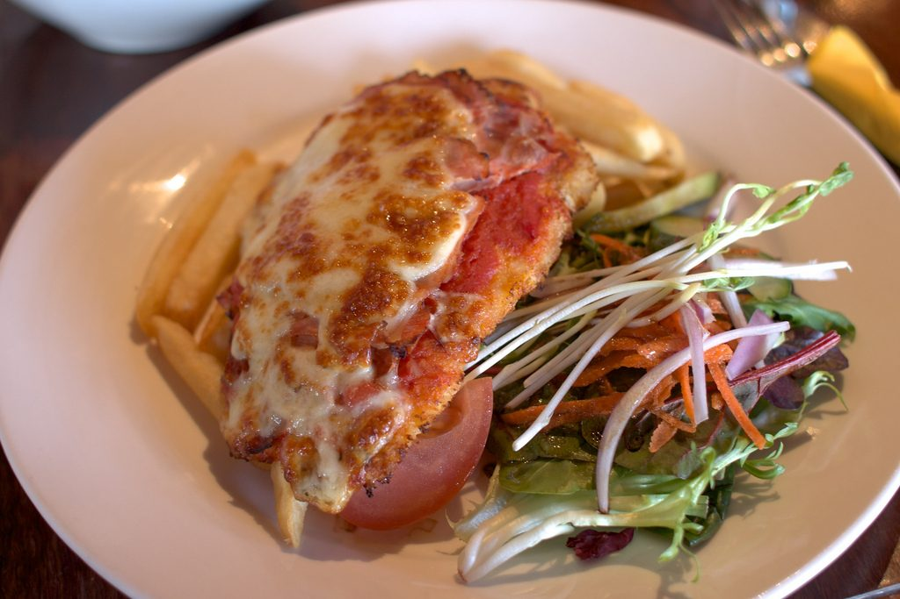

# Chicken Parmesan

## Cultural Context
Chicken Parmesan, also called chicken parmigiana or chicken parm, is an Italian-American classic built from breaded cutlets, tomato sauce, mozzarella, and Parmesan. It reflects the foodways of Italian immigrant communities in the United States, where parmigiana-style sauced-and-cheesed dishes met widely available chicken. This version follows the home-cook consensus: thin cutlets, a Parmesan breadcrumb crust, a short pan-fry for color and crunch, and a hot oven finish so the cheese melts before the chicken dries out.

## Ingredients

### Main Components
- 680 g (1 1/2 lb) boneless skinless chicken breasts, about 2 large breasts, split horizontally into 4 cutlets
- 6 g (1 tsp) kosher salt, plus more to taste
- 1 g (1/2 tsp) freshly ground black pepper
- 60 g (1/2 cup) all-purpose flour
- 2 large eggs, beaten until frothy
- 60 g (1 cup) panko or Italian-style breadcrumbs
- 75 g (3/4 cup) freshly grated Parmesan cheese, divided
- 60 to 120 ml (1/4 to 1/2 cup) olive oil or neutral oil, for pan-frying

### For the Sauce, Cheese, and Garnish
- 360 to 720 ml (1 1/2 to 3 cups) marinara sauce, warmed, divided
- 115 g (4 oz / 1 cup) low-moisture mozzarella, shredded, or fresh mozzarella cut into small pieces
- 55 g (1/2 cup) provolone, shredded, optional but recommended
- 8 g (1/4 cup) fresh basil leaves, torn or chopped
- 10 ml (2 tsp) olive oil, for finishing
- Cooked spaghetti, garlic bread, or a green salad, for serving

**Substitutions:**
- Panko breadcrumbs -> Italian-style breadcrumbs for a finer, more traditional coating
- Provolone -> additional mozzarella for a milder cheese topping
- All-purpose flour -> gluten-free flour blend, paired with gluten-free breadcrumbs
- Chicken breasts -> prepared chicken cutlets, reducing pounding time

## Equipment
- Cutting board and sharp knife
- Plastic wrap or a large zip-top bag
- Meat mallet, rolling pin, or heavy skillet
- 3 shallow bowls or pie plates
- Large skillet
- 9 x 13 in (23 x 33 cm) baking dish or rimmed baking sheet
- Instant-read thermometer

## Instructions

### Preparation (Active time: 15 min)
1. **Preheat and prepare the chicken:** Heat the oven to 425°F (218°C). Split the chicken breasts horizontally into 4 cutlets. Place the cutlets between plastic wrap or inside a split zip-top bag and pound to an even 1/3 to 1/2 in (8 to 12 mm) thickness. Season both sides with the salt and pepper.

2. **Set up the breading station:** Put the flour in one shallow bowl, the beaten eggs in a second, and the breadcrumbs plus 50 g (1/2 cup) of the Parmesan in a third. Dredge each cutlet in flour and tap off the excess, dip in egg, then press firmly into the breadcrumb mixture so both sides are evenly coated.

3. **Rest the coating:** Transfer the breaded cutlets to a plate or rack and let them stand for 5 to 15 minutes. This short rest helps the crust cling during frying.

### Cooking (Active time: 20 min)
4. **Pan-fry the cutlets:** Heat 60 ml (1/4 cup) oil in a large skillet over medium to medium-high heat until shimmering. Fry the chicken in batches without crowding, adding more oil only if the pan gets dry, until deeply golden, about 2 to 4 minutes per side. The chicken does not need to be fully cooked yet.

5. **Assemble for baking:** Spread 180 ml (3/4 cup) marinara in the baking dish if you prefer a saucier casserole-style version, or skip the bottom sauce and use a lightly oiled baking dish for a crisper underside. Arrange the cutlets in a single layer. Spoon 2 to 4 tbsp marinara over each cutlet, keeping some crust exposed. Top with mozzarella, provolone if using, basil, the remaining 25 g (1/4 cup) Parmesan, and a light drizzle of olive oil.

6. **Bake to finish:** Bake until the cheese is melted and browned in spots, the sauce is bubbling, and the thickest part of each cutlet reaches 165°F (74°C), about 12 to 18 minutes. Rest for 3 to 5 minutes before serving so the juices settle and the cheese stops bubbling.

### Assembly & Finishing
7. **Serve:** Serve hot with extra warm marinara on the side. For a classic family dinner, plate each cutlet over spaghetti; for a lighter plate, serve with Caesar salad, roasted broccoli, or a simple arugula salad.

8. **Keep the crust lively:** If serving over pasta, sauce the pasta separately and set the cutlet on top at the last minute rather than burying it in sauce.

## Food Safety & Storage
- **Minimum safe internal temperature:** Cook chicken to 165°F (74°C), checked in the thickest part of each cutlet.
- **Raw chicken handling:** Keep raw chicken and its juices away from ready-to-eat foods. Wash hands, boards, and utensils after breading.
- **Storage:** Refrigerate leftovers in an airtight container within 2 hours and keep for up to 3 days.
- **Freezing:** Freeze cooked cutlets, preferably without pasta, for up to 2 months. Wrap tightly and thaw overnight in the refrigerator.
- **Reheating:** Reheat uncovered in a 375°F (190°C) oven or toaster oven until hot and re-crisped. Add a spoonful of sauce before reheating if the chicken seems dry.

## Serving Suggestions
- Serve with spaghetti, rigatoni, garlic bread, Caesar salad, roasted asparagus, or sauteed green beans.
- Pair with sparkling water with lemon, iced tea, Chianti, or a medium-bodied red table wine.
- Traditional serving style: a sauced breaded cutlet under melted cheese, either plated as a main dish, set over pasta, or tucked into a toasted roll as a chicken parm sandwich.

## Scaling Notes
**Half recipe (1/2x):** Use 2 cutlets, 1 egg, and a smaller skillet or quarter-sheet pan. Baking time stays about the same.

**Double recipe (2x):** Fry in batches and bake on two sheet pans or in two baking dishes. Rotate pans halfway through baking and check each cutlet for 165°F (74°C).

## Chef's Notes
- **Sourcing:** Use freshly grated Parmesan when practical; pre-grated cheese can make the crust less crisp. Choose a thick, flavorful marinara because the sauce is a major seasoning.
- **Make-ahead:** Bread and pan-fry the cutlets up to 1 day ahead, then refrigerate. Top with sauce and cheese just before baking, adding a few extra minutes from cold.
- **Variations:** Add 1/2 tsp dried oregano or Italian seasoning to the breadcrumb mixture, or use fontina in place of provolone for a softer melt.
- **Common pitfalls:** Thick cutlets cook unevenly, crowded pans steam instead of brown, and too much sauce can soften the crust. Pound evenly, fry in batches, and serve extra sauce on the side.

## Nutrition Information (Optional)
*Per serving: approximately 500 kcal*
- Protein: 43g | Fat: 24g | Carbohydrates: 28g | Fiber: 2g

## Sources
- Allrecipes, Chicken Parmesan by John Mitzewich: https://www.allrecipes.com/recipe/223042/chicken-parmesan/
- Natasha's Kitchen, Chicken Parmesan: https://natashaskitchen.com/chicken-parmesan-recipe/
- The Kitchn, We Tested 4 Popular Chicken Parmesan Recipes and Found a Clear Winner: https://www.thekitchn.com/chicken-parmesan-recipe-reviews-23004303
- Wikipedia, Chicken parmesan cultural and historical overview: https://en.wikipedia.org/wiki/Chicken_parmesan
- Hero image source: https://commons.wikimedia.org/wiki/File:Chicken_parmigiana.jpg
- Downloaded image file: https://upload.wikimedia.org/wikipedia/commons/1/12/Chicken_parmigiana.jpg

---

**Version History:**
- v1 (2026-06-29): Initial recipe by @Codex

**Credits:**
- Recipe development: @Codex, adapted from the sources listed above
- Testing: @Codex
- Verification: @Coordinator
- Photography: Tristan Kenney, Wikimedia Commons, CC BY 2.0, https://commons.wikimedia.org/wiki/File:Chicken_parmigiana.jpg

---

**Recipe Location:** `/Recipe-of-the-Week/Recipes/2026-06-29_chicken-parmesan.md`  
**Images Location:** `/Recipe-of-the-Week/Images/chicken-parmesan/`
