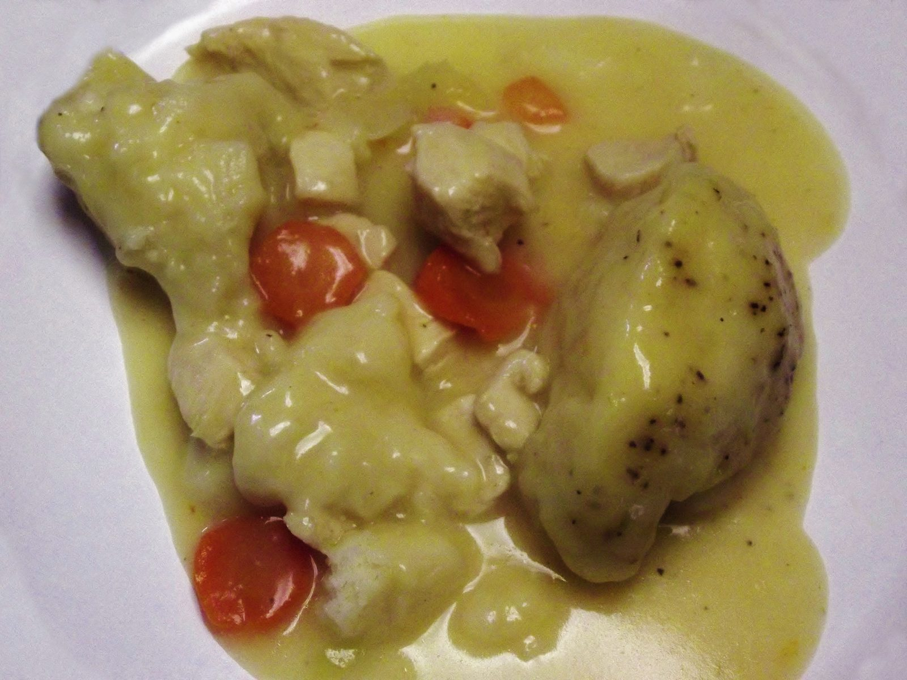

# Southern Chicken and Dumplings

## Cultural Context
Chicken and dumplings is home cooking across much of the Southern United States. The defining Southern version pairs tender chicken and concentrated broth with simple rolled strips of dough, sometimes called slick or flat dumplings. This recipe follows that tradition, using buttermilk for a tender dumpling and the chicken's cooking liquid as the base of the finished dish.

## Ingredients

### Chicken and Broth
- 1 whole chicken, 3 to 3 1/2 lb (1.36 to 1.59 kg), giblets removed
- 8 cups (1.9 L) water
- 1 medium yellow onion, quartered
- 2 medium carrots, cut into 2-inch pieces
- 2 celery stalks, cut into 2-inch pieces
- 2 bay leaves
- 2 tsp Diamond Crystal kosher salt, divided
- 1/2 tsp freshly ground black pepper, plus more for serving

### Rolled Buttermilk Dumplings
- 2 cups (240 g) all-purpose flour, plus more for rolling
- 1/2 tsp baking soda
- 1/2 tsp Diamond Crystal kosher salt
- 3 tbsp (36 g) nonhydrogenated vegetable shortening, chilled
- 3/4 cup (180 ml) whole buttermilk, chilled

### For Finishing
- 2 tbsp finely chopped fresh chives or flat-leaf parsley

**Substitutions:**
- Whole chicken → 3 lb (1.36 kg) bone-in, skin-on chicken thighs; keep the same 165°F (74°C) safety target
- Nonhydrogenated vegetable shortening → 3 tbsp (42 g) cold unsalted butter; the dumplings will taste richer and slightly less neutral
- Buttermilk → 3/4 cup (180 ml) whole milk mixed with 2 tsp lemon juice and rested for 5 minutes

## Equipment
- 6- to 8-quart Dutch oven or heavy pot with a lid
- Instant-read thermometer
- Rolling pin
- Fine-mesh strainer

## Instructions

### Preparation (Active time: 30 min)
1. **Start the chicken:** Put the chicken, water, onion, carrots, celery, bay leaves, 1 tsp salt, and black pepper in the pot. Bring just to a boil over medium-high heat, then immediately lower the heat to maintain a gentle simmer. Partially cover and cook for 45 to 60 minutes, turning the chicken once, until the thickest part of the breast and the innermost thigh both reach 165°F (74°C).

2. **Strain and pick the chicken:** Transfer the chicken to a rimmed tray. Strain the broth, discard the cooked vegetables and bay leaves, and return 6 cups (1.4 L) broth to the pot. When the chicken is cool enough to handle, remove and discard the skin and bones. Tear the meat into bite-size pieces; you should have about 4 cups (560 g). Keep the meat refrigerated if it will stand longer than 30 minutes.

3. **Make the dough:** Whisk the flour, baking soda, and 1/2 tsp salt in a bowl. Cut in the shortening with your fingertips or a pastry blender until the largest pieces are pea-size. Stir in the cold buttermilk just until a shaggy dough forms. Do not knead it smooth.

4. **Roll and cut the dumplings:** Turn the dough onto a well-floured surface. Pat it together, then roll it 1/8 inch (3 mm) thick. Cut into strips about 1 inch wide and 2 inches long. Dust lightly with flour so they do not stick; the loose flour will also give the broth a little body.

### Cooking (Active time: 15 min)
5. **Cook the dumplings:** Bring the 6 cups broth to a lively simmer. Drop in the dumplings one at a time, gently nudging them under the surface without vigorous stirring. Reduce the heat to medium-low, cover, and simmer for 12 minutes. Uncover and simmer for 5 to 8 minutes more, gently lifting from the bottom once or twice, until the dumplings are tender with no raw floury center.

6. **Return the chicken:** Fold in the shredded chicken and remaining 1 tsp salt. Simmer for 3 to 5 minutes, until the chicken is steaming and the center of the pot reaches 165°F (74°C). The broth should lightly coat a spoon but still be loose enough to ladle.

### Assembly & Finishing
7. **Rest the pot:** Remove from the heat and let stand for 5 minutes. Taste the broth and add black pepper or a small pinch of salt only if needed.

8. **Garnish and serve:** Ladle the chicken, dumplings, and broth into warm bowls. Scatter with chives or parsley and serve hot.

## Food Safety & Storage
- **Minimum safe internal temperature:** Cook the whole chicken to 165°F (74°C) in both the thickest breast and innermost thigh; reheat the finished dish to 165°F (74°C)
- **Storage:** Refrigerate in shallow airtight containers within 2 hours and use within 3 days
- **Freezing:** Freeze for up to 2 months; the dumplings will soften but remain usable
- **Reheating:** Warm gently on the stovetop with a splash of water or unsalted broth, stirring carefully, until the center reaches 165°F (74°C)

## Serving Suggestions
- Serve with braised green beans, collard greens, or a crisp cabbage slaw
- Add hot sauce at the table so each person can choose the heat level
- Traditional serving style: Spoon into deep bowls with plenty of broth and cracked black pepper

## Scaling Notes
**Half recipe (1/2x):** Use 1 1/2 to 2 lb (680 to 910 g) bone-in chicken pieces and a 4- to 5-quart pot. Begin checking the chicken after 30 minutes, but rely on the 165°F (74°C) internal temperature.

**Double recipe (2x):** Cook the chickens in separate pots or use one 12-quart stockpot so they stay submerged. Roll the dough in two batches and add the dumplings gradually to keep the broth simmering; allow 5 to 10 extra minutes for the pot to return to temperature.

## Chef's Notes
- **Sourcing:** A chicken around 3 to 3 1/2 lb (1.36 to 1.59 kg) cooks more evenly in this timeframe than a large roasting bird. Check that packaged shortening is labeled nonhydrogenated and contains 0 g trans fat.
- **Make-ahead:** Cook and pick the chicken and strain the broth up to 2 days ahead. Refrigerate them separately; make and cook the dumplings just before serving.
- **Variations:** Some Southern families prefer fluffy drop dumplings, while others use very thin rolled squares. These rolled strips land between noodle-like slicks and soft, puffy dumplings.
- **Common pitfalls:** Keep the broth at a steady simmer after the dough goes in. A hard boil can tear the dumplings, while a weak simmer can leave their centers gummy.
- **Richness:** This is a hearty main dish. Removing the chicken skin before serving keeps the broth full-flavored without making each bowl excessively fatty.

## Nutrition Information (Optional)
*Per serving: approximately 480 kcal*
- Protein: 38 g | Fat: 17 g | Carbohydrates: 42 g | Fiber: 2 g
- Sodium: approximately 650 mg | Saturated fat: approximately 4 g | Added sugar: 0 g

## Sources
- [Southern Living: Old-Fashioned Chicken and Dumplings](https://www.southernliving.com/recipes/old-fashioned-chicken-dumplings-recipe) - primary reference for the whole-chicken broth and rolled buttermilk dumplings
- [Paula Deen: Easy Southern Chicken and Dumplings](https://www.pauladeen.com/recipe/southern-chicken-and-dumplings-recipe/) - reference for the traditional rolled-dumpling method and family-style serving
- [King Arthur Baking: Chicken and Dumplings](https://www.kingarthurbaking.com/recipes/chicken-and-dumplings-recipe) - ratio and technique cross-check for tender buttermilk dumplings
- [Wikimedia Commons: Chicken and dumplings.JPG](https://commons.wikimedia.org/wiki/File:Chicken_and_dumplings.JPG) - hero image source

---

**Version History:**
- v1 (2026-08-08): Initial recipe by @Codex

**Credits:**
- Recipe development: @Codex; adapted from the sources listed above
- Testing: @Codex
- Verification: @Coordinator
- Photography: Amadscientist, [Wikimedia Commons](https://commons.wikimedia.org/wiki/File:Chicken_and_dumplings.JPG), licensed under [CC BY-SA 3.0](https://creativecommons.org/licenses/by-sa/3.0/); no changes made

---

**Recipe Location:** `/Recipe-of-the-Week/Recipes/2026-08-08_southern-chicken-and-dumplings.md`
**Images Location:** `/Recipe-of-the-Week/Images/southern-chicken-and-dumplings/`
