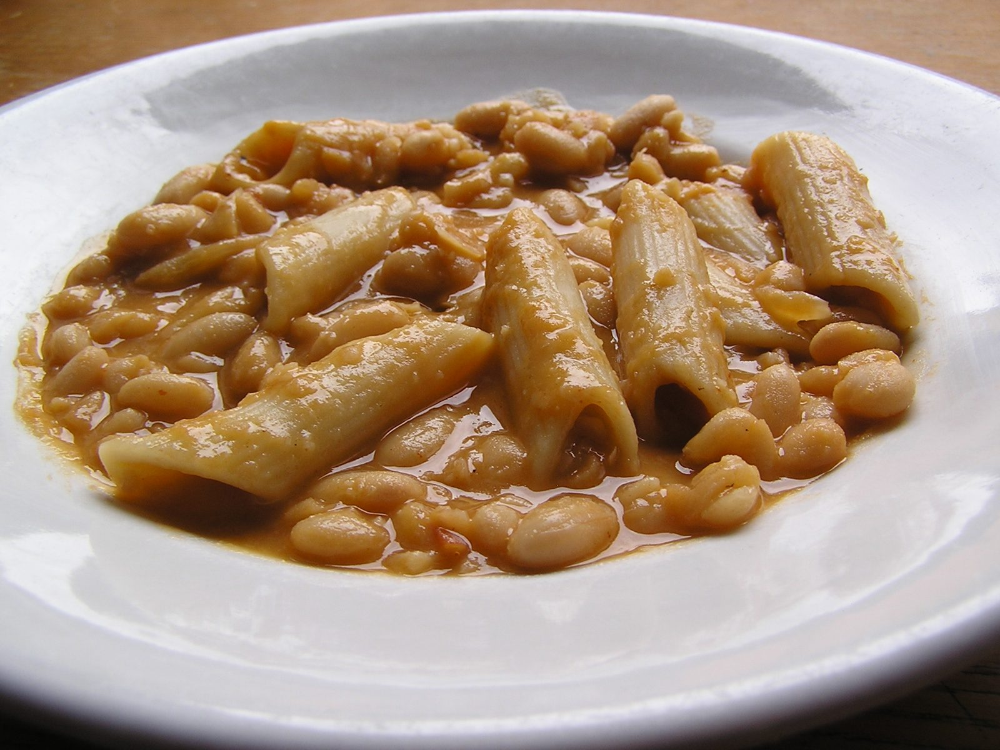

# Pasta e Fagioli

## Cultural Context
Pasta e fagioli means pasta and beans, a staple of Italian cucina povera with regional versions ranging from soup to thick pasta stew. [Great Italian Chefs](https://www.greatitalianchefs.com/recipes/pasta-e-fagioli-recipe-pasta-bean-soup) describes that variety. This tomato-and-kale adaptation makes a mild family supper from pantry beans; small pasta fits easily on a child's spoon.

## Ingredients

### Main Components
- 45 ml (3 tablespoons) extra-virgin olive oil
- 1 large yellow onion (about 200 g), finely diced
- 2 carrots (about 150 g), finely diced
- 2 celery ribs (about 100 g), finely diced
- 3/4 teaspoon fine sea salt, divided
- 1/4 teaspoon ground black pepper
- 4 garlic cloves, minced
- 425 g (15 oz) canned crushed tomatoes, no salt or sugar added
- 960 ml (4 cups) low-sodium vegetable broth, at most 140 mg sodium per cup; choose one without Big-9 allergens
- 720 ml (3 cups) water, plus up to 240 ml (1 cup) for thinning if needed
- 2 bay leaves
- 1 teaspoon dried oregano
- 2 cans cannellini beans, 425 g (15 oz) each before draining, no salt added; rinse and drain (about 3 cups cooked beans)
- 113 g (4 oz, about 1 cup) dried ditalini, made with wheat and water, without egg
- 60 g (2 cups) chopped Tuscan kale, tough stems removed
- 15 g (1/4 cup) chopped flat-leaf parsley

### For the Sauce/Garnish
- 15 ml (1 tablespoon) extra-virgin olive oil
- 15 ml (1 tablespoon) fresh lemon juice
- 30 g (about 6 tablespoons) finely grated Parmesan-style cheese, optional; choose pasteurized milk cheese without egg-derived lysozyme
- 1/4 teaspoon red pepper flakes, optional, passed at the table

**Substitutions:**
- Cannellini beans → the same quantity of canned Great Northern beans.
- Ditalini → the same weight of egg-free dried small shells; follow their doneness rather than the clock.
- Kale → the same weight of stemmed chopped chard.

## Equipment
- 6-quart heavy soup pot with lid
- Knife, cutting board, measuring cups and spoons
- Colander and wooden spoon
- Potato masher and bowl
- Food thermometer for reheating

## Instructions

### Preparation (Active time: 15 min)
1. **Prepare the vegetables:** Wash the produce, dice the onion, carrots and celery into roughly 1/4-inch pieces, and chop the greens. Measure everything before heating the pot. Drain and rinse the beans; mash 3/4 cup thoroughly in a bowl with a fork or potato masher.

### Cooking (Active time: 18 min)
2. **Soften the base:** Heat 3 tablespoons oil over medium heat. Add onion, carrots, celery, 1/2 teaspoon salt and black pepper. Stir frequently for 6–10 minutes, until the onion is translucent and the carrots begin to soften. Add garlic for 30 seconds, then tomatoes; let them bubble across the surface.
3. **Simmer:** Add broth, 3 cups water, bay leaves and oregano. Bring to a gentle simmer and cook for 10 minutes. Stir in the mashed beans, remaining whole beans, pasta, kale and parsley. Simmer uncovered for about 15–20 minutes, stirring along the bottom every 2–3 minutes. Begin tasting the pasta at its package cooking time; stop when it and the greens are tender. Add the reserved thinning water in 1/4-cup increments only if the pasta needs more liquid.

### Assembly & Finishing
4. **Finish (Active time: 2 min):** Remove the bay leaves and take the pot off the heat. Stir in lemon juice, 1 tablespoon oil and the remaining 1/4 teaspoon salt.
5. **Garnish and serve:** Divide among 6 bowls. Offer the measured cheese and red pepper flakes separately so each person can choose their topping. The soup thickens as it stands; serve promptly.

## Food Safety & Storage
- **Minimum safe internal temperature:** No raw animal protein is used. Reheated leftovers must reach 165°F (74°C) throughout; bring soup to a rolling boil while stirring and check with a thermometer.
- **Storage:** Divide into shallow containers and refrigerate within 2 hours, or 1 hour above 90°F (32°C). Do not wait for a full pot to cool on the counter. Keep at 40°F (4°C) or below and use within 3–4 days.
- **Freezing:** Freeze individual portions for up to 3 months for best quality. Pasta will soften after thawing. Thaw in the refrigerator.
- **Reheating:** Add a splash of water, stir frequently, and heat to the temperature above.
- **Allergens:** Wheat pasta contains gluten; the optional cheese contains dairy. The specified pasta, broth and cheese avoid additional Big-9 ingredients. Check replacement products, especially egg in pasta or cheese and soy in broth. Use only canned or already fully cooked beans here.

## Serving Suggestions
- Serve as the main course in deep bowls, with the cheese at the table.
- A cucumber-and-tomato salad makes a fresh side; side dishes are outside the nutrition estimate.
- The representative photograph shows a thicker penne version without kale; this recipe produces a soup with small pasta.

## Scaling Notes
**Half recipe (½×):** Use a 3-quart pot and halve every ingredient, including the finishing ingredients. Keep the same simmering and pasta doneness checks.

**Double recipe (2×):** Use two 6-quart pots for 12 servings. Split the ingredients equally; a crowded pot takes longer to heat and is harder to stir and cool safely.

## Chef's Notes
- **Sourcing:** Use no-salt-added beans and tomatoes and the specified low-sodium broth; ordinary canned products can substantially raise the sodium estimate.
- **Make-ahead:** Prepare through the first 10-minute simmer in step 3, then cool and refrigerate promptly. Within 3–4 days, bring the base back to a boil before adding beans, pasta and greens and completing the recipe.
- **Variations:** Regional versions use different beans, pasta shapes and pork seasonings. This adaptation keeps the vegetables and canned beans of Cookie and Kate's version, mashes the reserved beans instead of blending hot soup, and puts chili at the table.
- **Common pitfalls:** Pasta can stick before the soup looks thick. Scrape the bottom gently while stirring, and judge the pasta by tasting; brands cook at different rates in tomato broth.
- **Review status:** Source-based desk review only; this batch has not been physically cooked or taste-tested. The required front-matter handles identify the automation roles.

## Nutrition Information (Optional)
*Per serving: approximately 330 kcal, including 5 g optional cheese; excludes side dishes.*
- Protein: 13 g | Fat: 12 g | Carbohydrates: 43 g | Fiber: 9 g
- Sodium: approximately 450 mg | Saturated fat: approximately 2.5 g | Added sugar: 0 g
- Estimate basis: sodium for the pot is approximately 1,725 mg from salt + up to 560 mg from broth + 180 mg from vegetables and no-salt-added canned foods + 230 mg from cheese = 2,695 mg; divided by 6 is about 450 mg. Saturated fat is approximately (9 g from oil + 5 g from cheese + 1 g from other ingredients) / 6 = 2.5 g. Product labels and drained bean yield will change these estimates; this is not a low-sodium claim.

---

## Sources
Research checked on 2026-09-12. Adapted from the listed recipes; measurements and cooking methods were cross-checked, with the specific adjustments noted above.
- [Cookie and Kate: Pasta e Fagioli](https://cookieandkate.com/pasta-e-fagioli-recipe/) — main ingredient ratios and tomato, kale, lemon and olive-oil finish; displayed 5/5 from 427 reviews on the research date, with recent family-cooking comments. Selected for established reader enthusiasm rather than a claimed new trend.
- [Valeria Necchio / Great Italian Chefs: Pasta e fagioli](https://www.greatitalianchefs.com/recipes/pasta-e-fagioli-recipe-pasta-bean-soup) — Italian context, pasta cooked in bean liquid, and table cheese.
- [Sara Jenkins / James Beard Foundation: Pasta e Fagioli](https://www.jamesbeard.org/recipes/pasta-e-fagioli) — comparison for thickening with puréed beans and preparing the base ahead.
- [USDA FSIS: Leftovers and Food Safety](https://www.fsis.usda.gov/food-safety/safe-food-handling-and-preparation/food-safety-basics/leftovers-and-food-safety) — cooling, storage and reheating guidance.
- [Wikimedia Commons image source and license](https://commons.wikimedia.org/wiki/File:Pasta_e_fagioli_cannellini.jpg); [original JPEG](https://upload.wikimedia.org/wikipedia/commons/8/85/Pasta_e_fagioli_cannellini.jpg).

**Version History:**
- v1 (2026-09-12): Initial recipe adaptation by @Codex.

**Credits:**
- Recipe adaptation: @Codex, from Kathryne Taylor, Valeria Necchio and Sara Jenkins as linked above.
- Testing: @Codex — automated checks and desk review; not kitchen-tested.
- Verification: @Coordinator — workflow metadata; no separate human sign-off claimed.
- Photography: Spinoziano, “Pasta e fagioli cannellini,” Wikimedia Commons, [CC BY-SA 4.0](https://creativecommons.org/licenses/by-sa/4.0/). [Source](https://commons.wikimedia.org/wiki/File:Pasta_e_fagioli_cannellini.jpg). Original JPEG retained unchanged; the HTML renderer resizes and recompresses its embedded copy. The photograph and that resized copy remain under CC BY-SA 4.0.

---

