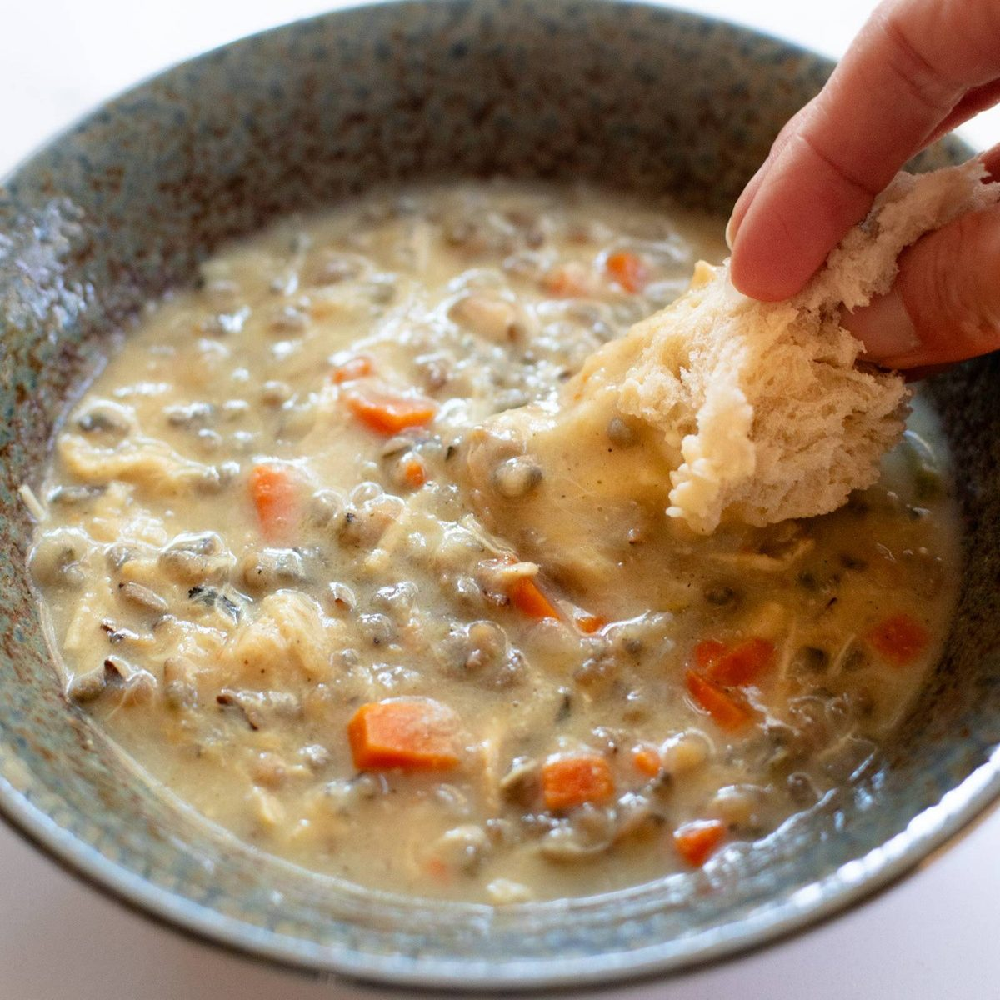

# Creamy Chicken and Wild Rice Soup

## Cultural Context
Creamy wild rice soup is closely associated with Minnesota, where wild rice is the state grain and a familiar ingredient in home kitchens. This chicken version follows the Midwestern pattern found across the sources: tender wild rice, chicken, carrots, celery, and onion finished with a simple milk-thickened broth. It is adapted from the recipes listed below, with a stovetop method and a thermometer-based doneness check.

## Ingredients

### Main Components
- 170 g (6 oz / 3/4 cup) uncooked wild rice, rinsed and drained - use true wild rice, not a quick-cooking blend
- 680 g (1 1/2 lb) boneless, skinless chicken breasts
- 1.2 L (40 fl oz / 5 cups) low-sodium chicken broth
- 130 g (4.5 oz / 1 cup) carrots, diced
- 100 g (3.5 oz / 1 cup) celery, diced
- 150 g (5.3 oz / 1 cup) yellow onion, diced
- 2 cloves garlic, minced
- 1 teaspoon dried thyme
- 1/2 teaspoon rubbed sage
- 1/2 teaspoon ground black pepper, plus more to taste
- 1 bay leaf

### For the Creamy Finish
- 28 g (1 oz / 2 tablespoons) unsalted butter
- 24 g (0.8 oz / 3 tablespoons) all-purpose flour
- 240 ml (8 fl oz / 1 cup) whole milk, warmed
- 1/2 teaspoon kosher salt, plus more only if needed
- 2 tablespoons chopped fresh parsley (optional)

**Substitutions:**
- Whole milk → half-and-half for a richer soup, or evaporated milk for similar body
- Chicken breasts → boneless, skinless chicken thighs; cook to the same safe temperature
- True wild rice → a wild rice blend, following the package timing because blends cook faster

## Equipment
- 5- to 6-quart Dutch oven or heavy soup pot with lid
- Small saucepan
- Whisk
- Instant-read thermometer

## Instructions

### Preparation (Active time: 15 min)
1. **Prepare the vegetables and rice:** Rinse the wild rice under cool water until the water runs mostly clear. Dice the carrots, celery, and onion into roughly 1/4-inch pieces so they soften at the same rate.

2. **Build the soup base:** Add the wild rice, chicken breasts, broth, carrots, celery, onion, garlic, thyme, sage, pepper, and bay leaf to the Dutch oven. Bring to a gentle boil over medium-high heat, then reduce the heat to maintain a steady simmer.

### Cooking (Active time: 10 min)
3. **Cook the chicken and rice:** Cover and simmer for 25 to 35 minutes, checking the chicken at 25 minutes. Transfer each breast to a clean plate as soon as its thickest part reaches 165°F (74°C). Keep the rice covered and simmering until the grains split open and become tender but still pleasantly chewy, 45 to 60 minutes total depending on the rice.

4. **Make the creamy base:** During the last 10 minutes of the rice's cooking time, melt the butter in the small saucepan over medium heat. Whisk in the flour and cook for 1 minute. Add the warm milk about 1/3 cup at a time, whisking smooth after each addition. Cook, whisking, for 3 to 5 minutes, until the sauce lightly coats the back of a spoon.

### Assembly & Finishing
5. **Finish the soup:** Shred or dice the cooked chicken. Remove the bay leaf, then stir the milk mixture and chicken into the pot. Simmer gently for 3 to 5 minutes, stirring often, until the soup is creamy and the chicken is hot. Do not boil hard after adding the milk. Stir in the salt, taste, and add more pepper or salt only if needed.

6. **Garnish and serve:** Ladle into warm bowls and scatter parsley over the top, if using. The soup will thicken as it stands; loosen it with a splash of broth or milk if needed.

## Food Safety & Storage
- **Minimum safe internal temperature:** Cook the chicken to 165°F (74°C) in its thickest part, measured with an instant-read thermometer.
- **Storage:** Divide leftovers among shallow airtight containers and refrigerate within 2 hours. Keep for up to 4 days.
- **Freezing:** Freeze for up to 2 months. Dairy-based soup may look slightly separated after thawing, but gentle reheating and stirring will bring it back together.
- **Reheating:** Reheat on the stovetop over medium-low heat, stirring often, or microwave in short intervals until the center reaches 165°F (74°C). Thin with broth or milk as needed.

## Serving Suggestions
- Serve with crusty bread, biscuits, or a simple green salad.
- A crisp apple slaw makes a fresh counterpoint to the creamy broth.
- In Minnesota-style home cooking, this is often served as a full meal with bread for dipping.

## Scaling Notes
**Half recipe (1/2x):** Use a 3- to 4-quart pot. Begin checking the rice at 40 minutes; the cooking time will not be cut in half.

**Double recipe (2x):** Use an 8-quart pot and make the milk mixture in a larger saucepan. Keep the broth at a steady simmer and allow another 5 to 15 minutes for the larger volume to return to temperature.

## Chef's Notes
- **Sourcing:** True wild rice has long, dark grains and a firm, nutty chew. Rice blends contain other varieties and need different cooking times.
- **Make-ahead:** Dice the vegetables and combine the dry seasonings up to 2 days ahead. The finished soup also reheats well, though the rice absorbs broth overnight.
- **Variations:** Sliced mushrooms are common in creamy wild rice soups; saute 225 g (8 oz) with the vegetables before adding the broth.
- **Common pitfalls:** Remove the chicken as soon as it reaches 165°F (74°C) so it stays tender. If the rice is still firm when the chicken is ready, keep simmering the rice on its own.
- **Nutrition note:** This is a creamy main-dish soup. Using low-sodium broth and seasoning at the end keeps the sodium in check, while the butter and whole milk make it moderately rich.

## Nutrition Information (Optional)
*Per serving: approximately 390 kcal*
- Protein: 32 g | Fat: 11 g | Carbohydrates: 40 g | Fiber: 4 g

## Sources
- [Pinch of Yum: Crockpot Chicken Wild Rice Soup](https://pinchofyum.com/crockpot-chicken-wild-rice-soup) - ingredient and flavor reference; 4.5 stars from 212 reviews at research time
- [Food.com: Minnesota Cream of Chicken & Wild Rice Soup](https://www.food.com/recipe/minnesota-cream-of-chicken-wild-rice-soup-134627) - stovetop proportions and community feedback; 49 reviews at research time
- [Midwest Living: Chicken and Wild Rice Soup](https://www.midwestliving.com/recipe/soups/chicken-and-wild-rice-soup/) - Midwestern preparation reference
- [Chef Billy Parisi: Creamy Chicken and Wild Rice Soup](https://www.billyparisi.com/chicken-wild-rice-soup-recipe/) - soup history and technique reference
- [Hero image source](https://pinchofyum.com/tachyon/Chicken-Wild-Rice-Soup-1.jpg?resize=1200%2C1200) - Lindsay Ostrom / Pinch of Yum

---

**Version History:**
- v1 (2026-10-03): Initial recipe by @Codex

**Credits:**
- Recipe development: @Codex, adapted from the sources above
- Testing: @Codex
- Verification: @Coordinator
- Photography: Lindsay Ostrom / Pinch of Yum ([source](https://pinchofyum.com/crockpot-chicken-wild-rice-soup))

---

**Recipe Location:** `/Recipe-of-the-Week/Recipes/2026-10-03_creamy-chicken-and-wild-rice-soup.md`  
**Images Location:** `/Recipe-of-the-Week/Images/creamy-chicken-and-wild-rice-soup/`
