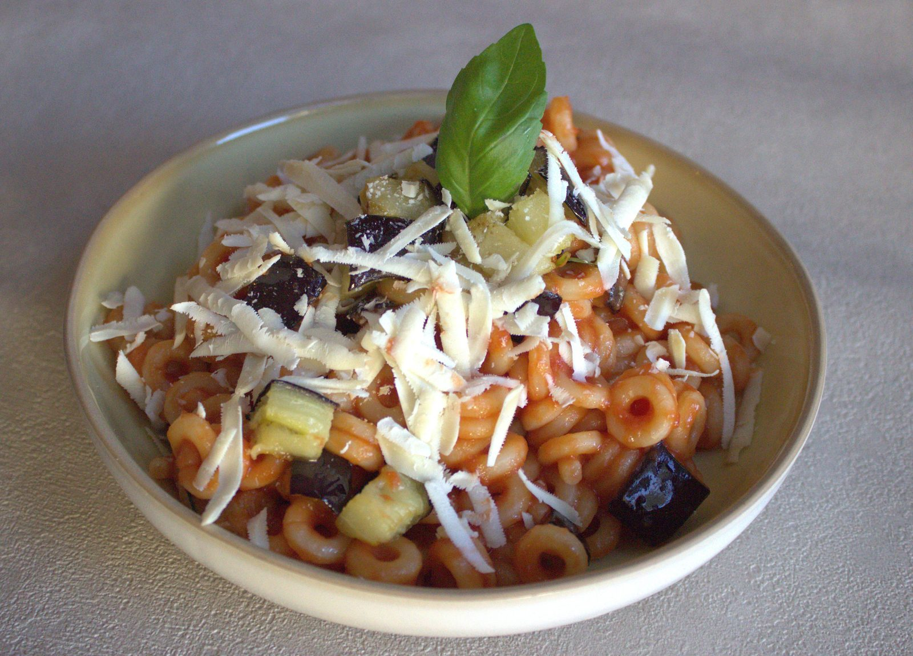

# Pasta alla Norma

## Cultural Context
Pasta alla Norma comes from Catania, Sicily: eggplant, tomato, basil, and salted ricotta turn a simple pasta supper into a regional favorite. Great Italian Chefs describes its traditional fried-eggplant preparation. This adaptation uses RecipeTin Eats' roasted method for an easier family dinner, with ricotta salata to finish. The tomato sauce stays mild; chili is optional.

## Ingredients

### Main Components
- 800 g (1 lb 12 oz) eggplant, trimmed and cut into 1-inch (2.5 cm) cubes
- 30 ml (2 tablespoons) extra-virgin olive oil, for roasting
- 1/2 teaspoon fine salt, for the eggplant
- 1/2 teaspoon ground black pepper, for the eggplant
- 300 g (10.6 oz) dried egg-free durum-wheat rigatoni
- 3 liters water and 1 teaspoon fine salt, for boiling pasta

### For the Sauce/Garnish
- 30 ml (2 tablespoons) extra-virgin olive oil
- 2 garlic cloves, finely minced
- 1/2 small onion (about 60 g), finely chopped
- 700 g (24.7 oz) plain tomato passata, preferably no-salt-added
- 60 ml (1/4 cup) water
- 1 teaspoon dried oregano
- 1/2 teaspoon fine salt
- 1/2 teaspoon ground black pepper
- 1/2 teaspoon crushed red pepper flakes (optional)
- 1/2 cup loosely packed fresh basil leaves, roughly torn
- 40 g (1.4 oz) pasteurized-milk ricotta salata, grated

**Substitutions:**
- Rigatoni → the same weight of egg-free penne.
- Ricotta salata → the same weight of pasteurized-milk Pecorino Romano; it will taste sharper and saltier. Both contain dairy.

## Equipment
- Large rimmed baking sheet and parchment rated for the oven temperature
- Large pasta pot and colander
- Large deep skillet and spatula
- Grater and instant-read thermometer for reheating leftovers

## Instructions

### Preparation (Active time: 10 min)
1. **Heat the oven:** Set it to 450°F (230°C conventional; 220°C fan). Line the baking sheet with suitable parchment, or use the bare metal sheet. Wash and cut the eggplant, mince the garlic, and chop the onion.
2. **Season:** Toss eggplant with its 2 tablespoons oil, 1/2 teaspoon salt, and 1/2 teaspoon pepper. Spread in one layer with room between the pieces; use a second sheet if crowded.

### Cooking (Active time: 12 min)
3. **Roast:** Cook for 20 minutes, turn the cubes, then roast about 5 minutes more. The surfaces should brown and the centers should be soft all the way through. Let the eggplant sit on its tray while finishing the sauce.
4. **Simmer:** While the eggplant roasts, heat the remaining oil in the skillet over medium heat. Stir in garlic for 20 seconds, then onion for 2–3 minutes, until softened; avoid scorching. Add passata, 1/4 cup water, oregano, the sauce salt and pepper, and optional chili. Simmer gently for 5 minutes, stirring occasionally, then hold on low heat.
5. **Boil:** Meanwhile, bring the 3 liters water and 1 teaspoon salt to a boil. Add rigatoni and cook according to its package, usually 10–12 minutes, until tender with a firm center. Reserve 1/2 cup cooking water before draining.

### Assembly & Finishing
6. **Toss gently:** Fold eggplant and drained pasta into the sauce over low heat. Loosen with reserved pasta water a tablespoon at a time if needed; stop when sauce coats the pasta without pooling. Allow about 3 minutes for finishing.
7. **Garnish and serve:** Divide among four bowls and distribute the basil and grated ricotta salata evenly. Serve hot, before the pasta absorbs more sauce.

## Food Safety & Storage
- **Minimum safe internal temperature:** No raw animal protein is used. Cook eggplant until fully tender; use pasteurized dairy. Reheat leftovers to 165°F (74°C), checked in several places.
- **Storage:** Refrigerate in shallow airtight containers within 2 hours, or within 1 hour above 90°F (32°C). Keep at 40°F (4°C) or below and use within 3–4 days.
- **Freezing:** Freeze cooled sauce and eggplant separately from freshly cooked pasta for best texture, up to 3 months for quality. Thaw in the refrigerator.
- **Reheating:** Warm covered in a skillet with a splash of water, stirring to heat evenly, until the temperature above is reached.
- **Allergens:** Wheat pasta contains gluten; ricotta salata and the cheese substitution contain dairy. Use egg-free dried pasta as specified and check packaged ingredient labels for additional allergens.

## Serving Suggestions
- Serve in shallow bowls with the cheese scattered on top, as a pasta main course.
- A plain green salad with lemon makes a fresh accompaniment.

## Scaling Notes
**Half recipe (½×):** Use half of each ingredient and a smaller skillet; start checking the eggplant at the same time.

**Double recipe (2×):** Use two baking sheets and rotate their positions while roasting. Toss in a very large pot or two batches; do not crowd the eggplant onto one sheet.

## Chef's Notes
- **Sourcing:** Ricotta salata is firm and grateable; soft tub ricotta gives a different finish.
- **Make-ahead:** Prepare sauce and eggplant a day ahead, refrigerate promptly, then reheat to 165°F (74°C) before combining with freshly cooked pasta.
- **Variations:** The traditional version shallow-fries the eggplant, as described by Great Italian Chefs. This recipe keeps the roasted method throughout.
- **Common pitfalls:** Crowded trays steam the eggplant; rough stirring breaks the softened cubes apart.
- **Adaptation:** The roasted eggplant proportions and quick passata sauce follow RecipeTin Eats. Wine is omitted, cheese is measured, and pasta-water salt is specified. Basil and ricotta salata retain the traditional finish documented by the other sources.
- **Review status:** @Codex performed a desk review and automated validation; this recipe has not been kitchen-tested. @Coordinator is the requested verification metadata, not a claim of independent tasting.

## Nutrition Information (Optional)
*Per serving: approximately 540 kcal; estimates vary with cheese and passata brands and pasta-water absorption.*
- Protein: 16 g | Fat: 18 g | Carbohydrates: 80 g | Fiber: 10 g
- Sodium: approximately 850 mg | Saturated fat: approximately 4 g | Added sugar: 0 g with unsweetened passata
- Sodium estimate: (2,300 mg from the 1 teaspoon salt added directly to food + about 500 mg from cheese + about 200 mg from tomatoes + about 400 mg retained from pasta water) / 4 = about 850 mg per bowl. Pasta-water retention is an estimate.
- Saturated-fat estimate: (about 8 g from olive oil + 7 g from cheese + 1 g from other ingredients) / 4 = about 4 g per bowl. This is a fairly salty pasta dinner, not a low-sodium dish.

## Sources
Researched on 2026-11-07. Adapted from the recipes below; ratings are snapshots from that date, not a claim of a new food trend.
- [RecipeTin Eats: Pasta alla Norma](https://www.recipetineats.com/pasta-alla-norma-eggplant-pasta/) — roasted method and sauce proportions; 4.99/5 from 77 votes at research time.
- [Great Italian Chefs: Pasta alla Norma](https://www.greatitalianchefs.com/recipes/pasta-alla-norma-recipe) — Sicilian context and traditional cheese-and-basil finish; displayed rating 5.00/5.
- [Allrecipes: Pasta alla Norma](https://www.allrecipes.com/recipe/260344/pasta-alla-norma/) — comparison of home-cooking method and serving style; 4.1/5 from 8 ratings.
- [Hero photograph source and license](https://commons.wikimedia.org/wiki/File:Pasta_alla_Norma_-_Wiki_Loves_Sicilia.jpg).
- [Direct image download](https://upload.wikimedia.org/wikipedia/commons/e/e4/Pasta_alla_Norma_-_Wiki_Loves_Sicilia.jpg?utm_campaign=index&utm_content=original&utm_source=commons.wikimedia.org).
- [USDA: Leftovers and Food Safety](https://www.fsis.usda.gov/food-safety/safe-food-handling-and-preparation/food-safety-basics/leftovers-and-food-safety) — cooling, storage, and reheating guidance.

---

**Version History:**
- v1 (2026-11-07): Initial adaptation and desk validation by @Codex.

**Credits:**
- Recipe adaptation: @Codex, from the sources listed above.
- Testing: @Codex (desk validation only; not kitchen-tested).
- Verification: @Coordinator (requested metadata; no independent tasting performed).
- Photography: 8w9d, "Pasta alla Norma - Wiki Loves Sicilia," 16 May 2025, via [Wikimedia Commons](https://commons.wikimedia.org/wiki/File:Pasta_alla_Norma_-_Wiki_Loves_Sicilia.jpg), [CC0 1.0](https://creativecommons.org/publicdomain/zero/1.0/). Representative dish photograph; the HTML renderer may downscale it.

---

