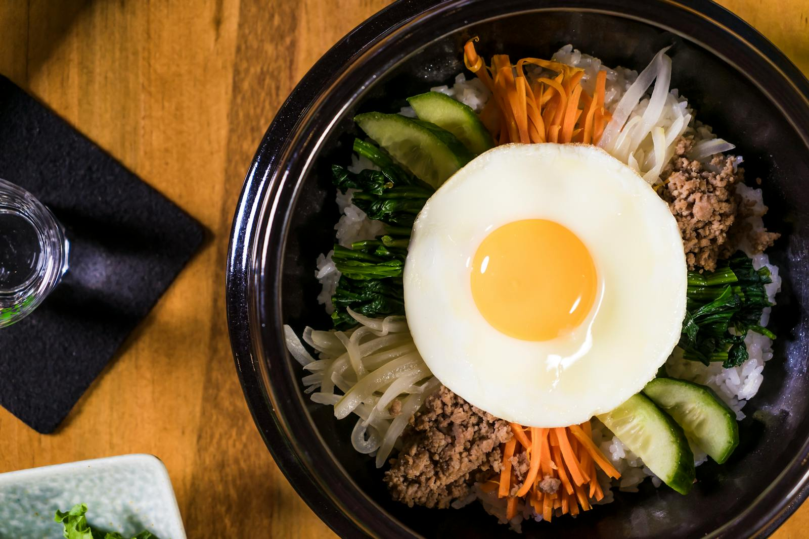

# Bibimbap (비빔밥)

## Cultural Context
Bibimbap, meaning "mixed rice" in Korean, is one of Korea's most iconic dishes and a cornerstone of Korean home cooking. Originating as a practical way to use leftover vegetables and rice, it evolved into a celebrated dish with regional variations across the Korean peninsula. Jeonju bibimbap from the Jeolla province is considered the gold standard, featuring an abundance of carefully prepared namul (seasoned vegetables). The dish embodies the Korean philosophy of balance — combining the five colors (obangsaek) representing the five elements — and is traditionally mixed thoroughly before eating, blending gochujang's heat with the richness of sesame oil and egg.

## Ingredients

### Rice
- 400 g (14 oz / 2 cups) short-grain white rice, rinsed until water runs clear
- 480 ml (16 fl oz / 2 cups) water

### Beef (Bulgogi-style)
- 225 g (8 oz) beef sirloin or ribeye, sliced into thin strips
- 30 ml (1 fl oz / 2 tbsp) soy sauce
- 15 ml (½ fl oz / 1 tbsp) sesame oil
- 10 g (2 tsp) sugar
- 2 cloves garlic, minced
- 5 g (1 tsp) freshly ground black pepper

### Namul (Seasoned Vegetables)
- 200 g (7 oz / 1 bunch) spinach, washed and trimmed
- 150 g (5 oz / 1 medium) carrot, julienned
- 150 g (5 oz / 1 medium) zucchini, julienned
- 200 g (7 oz / 1 cup) bean sprouts
- 150 g (5 oz) shiitake mushrooms, sliced
- 15 ml (1 tbsp) sesame oil, divided for each vegetable
- 10 g (2 tsp) toasted sesame seeds
- Salt to taste

### Gochujang Sauce
- 45 g (3 tbsp) gochujang (Korean red pepper paste)
- 15 ml (1 tbsp) sesame oil
- 15 ml (1 tbsp) rice vinegar
- 10 g (2 tsp) sugar
- 5 ml (1 tsp) water

### Toppings
- 4 large eggs
- 15 ml (1 tbsp) neutral oil (for frying eggs)
- Toasted sesame seeds for garnish
- Sliced scallions for garnish

**Substitutions:**
- Beef → firm tofu or marinated portobello mushrooms (for vegetarian; adjust soy marinade accordingly)
- Gochujang → sriracha mixed with a small amount of miso paste (less complex but serviceable)
- Short-grain rice → medium-grain rice (slightly less sticky texture)
- Soy sauce → tamari or coconut aminos (for gluten-free)

## Equipment
- Medium pot with lid (for rice)
- Large skillet or wok
- Small mixing bowls (for marinating and seasoning)
- Non-stick pan (for eggs)
- Stone pot / dolsot (optional, for dolsot bibimbap)

## Instructions

### Preparation (Active time: 20 min)
1. **Cook the rice:** Combine rinsed rice and water in a pot. Bring to a boil, reduce heat to low, cover, and cook for 15 minutes. Remove from heat and let steam, covered, for 10 minutes. The grains should be tender and slightly sticky.

2. **Marinate the beef:** Combine sliced beef with soy sauce, sesame oil, sugar, garlic, and black pepper in a bowl. Toss to coat evenly. Set aside for at least 15 minutes while you prepare the vegetables.

3. **Mix the gochujang sauce:** Whisk together gochujang, sesame oil, rice vinegar, sugar, and water in a small bowl until smooth. Set aside.

### Cooking the Namul (Active time: 20 min)
4. **Blanch the spinach:** Bring a pot of salted water to a boil. Add spinach and blanch for 30 seconds until wilted but still bright green. Drain and squeeze out excess water firmly. Toss with a splash of sesame oil, a pinch of salt, and sesame seeds.

5. **Sauté the carrots:** Heat a teaspoon of sesame oil in a skillet over medium-high heat. Cook julienned carrots for 2–3 minutes, stirring frequently, until just tender with a slight bite. Season with a pinch of salt. Transfer to a plate.

6. **Sauté the zucchini:** In the same skillet, add a teaspoon of sesame oil. Cook zucchini for 2 minutes until lightly golden at the edges but not mushy. Season with salt. Transfer to a plate.

7. **Cook the bean sprouts:** Add bean sprouts to the skillet with a splash of water. Cook for 2 minutes until slightly softened but still crunchy. Season with sesame oil and salt.

8. **Cook the mushrooms:** Add a teaspoon of sesame oil to the skillet. Sauté mushrooms for 3–4 minutes until golden brown and fragrant. Season with a pinch of salt.

### Cooking the Beef and Eggs (Active time: 5 min)
9. **Sear the beef:** Heat the skillet over high heat. Add the marinated beef in a single layer and cook for 2–3 minutes, turning once, until caramelized at the edges and cooked through. The beef should sizzle immediately when it hits the pan.

10. **Fry the eggs:** Heat neutral oil in a non-stick pan over medium heat. Crack eggs in one at a time and fry until the whites are set but the yolk is still runny, about 2–3 minutes. The edges should be slightly crispy.

### Assembly & Finishing
11. **Build the bowls:** Divide hot rice among four bowls. Arrange each namul vegetable, mushrooms, and beef in separate sections on top of the rice, creating a colorful pinwheel pattern around the bowl.

12. **Top and serve:** Place a fried egg in the center of each bowl. Add a generous spoonful of gochujang sauce on the side. Garnish with sesame seeds and sliced scallions. Instruct diners to mix everything together vigorously before eating — the runny yolk should coat the rice and vegetables.

## Food Safety & Storage
- **Minimum safe internal temperature:** 145°F (63°C) for beef; 160°F (71°C) for eggs if cooking fully
- **Storage:** Refrigerate individual components separately in airtight containers for up to 3 days
- **Freezing:** Cooked rice freezes well for up to 1 month; vegetables and beef are best fresh
- **Reheating:** Reheat rice and toppings separately; re-fry or microwave. Prepare fresh eggs when serving

## Serving Suggestions
- Serve with a side of kimchi and a light Korean soup such as miyeokguk (seaweed soup)
- Pairs well with Korean barley tea (boricha) or a crisp lager
- Traditional serving style: present assembled but unmixed, allowing each diner to add their desired amount of gochujang and mix at the table

## Scaling Notes
**Half recipe (½×):** Halve all ingredients directly; cooking times remain the same for individual vegetable batches.

**Double recipe (2×):** Cook vegetables and beef in batches to avoid overcrowding the pan, which would steam rather than sauté them. Rice can be doubled in a larger pot.

## Chef's Notes
- **Sourcing:** Gochujang is widely available in Asian grocery stores and increasingly in mainstream supermarkets. Look for brands with short ingredient lists (red pepper, rice, fermented soybean, salt).
- **Make-ahead:** All namul vegetables can be prepared up to a day in advance and stored refrigerated. Bring to room temperature or briefly reheat before assembling.
- **Variations:** For dolsot bibimbap, heat a stone pot with sesame oil, add rice and toppings, and cook on high heat for 5–8 minutes to develop a golden crispy rice crust (nurungji) on the bottom. Hwedeopbap is a raw fish variation popular in coastal regions.
- **Common pitfalls:** Overcrowding the pan when cooking vegetables leads to steaming rather than sautéing — cook each component separately. Don't skip squeezing water from the spinach, or it will make the bowl watery.

## Nutrition Information (Optional)
*Per serving: approximately 580 kcal*
- Protein: 28g | Fat: 18g | Carbohydrates: 72g | Fiber: 5g

---

**Version History:**
- v1 (2026-02-02): Initial recipe by @flavor_atlas_coordinator

**Credits:**
- Recipe development: @flavor_atlas_coordinator
- Testing: @flavor_atlas_coordinator
- Verification: @Coordinator
- Photography: pending

---

**Recipe Location:** `/Recipes/east-asian/east-asian_bibimbap_v1.md`
**Images Location:** `/Regions/Images/bibimbap/`
