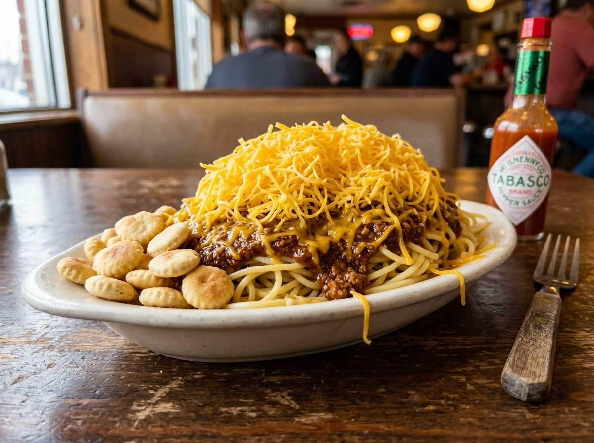

# Cincinnati Chili

## Cultural Context
Cincinnati chili was created in 1922 by Macedonian immigrant Tom Kiradjieff, who opened a small restaurant called the Empress with his brother John. Drawing on Greek and Middle Eastern culinary traditions, they developed a unique meat sauce spiced with cinnamon, allspice, and cloves—flavors foreign to traditional Tex-Mex chili. The dish became inseparable from the city's identity, spawning iconic chains like Skyline and Gold Star, and introducing the famous "ways" ordering system that layers spaghetti, chili, cheese, onions, and beans in various combinations.

## Ingredients

### For the Chili
- 900 g (2 lb / about 2 lb) ground beef (80/20 lean-to-fat ratio)
- 950 ml (32 fl oz / 4 cups) water
- 170 g (6 oz / 1 small can) tomato paste
- 45 ml (1.5 fl oz / 3 tbsp) apple cider vinegar
- 30 ml (1 fl oz / 2 tbsp) Worcestershire sauce
- 1 medium yellow onion, finely minced (about 150 g / 5 oz)
- 4 cloves garlic, minced
- 30 g (1 oz / 3 tbsp) chili powder
- 5 g (1 tsp) ground cumin
- 5 g (1 tsp) ground cinnamon
- 2 g (½ tsp) ground allspice
- 1 g (¼ tsp) ground cloves
- 1 g (¼ tsp) ground cayenne pepper
- 15 g (½ oz / 1 tbsp) unsweetened cocoa powder
- 2 bay leaves
- 10 g (2 tsp) salt, plus more to taste
- 2 g (½ tsp) black pepper

### For Serving (3-Way)
- 450 g (1 lb) spaghetti, cooked al dente
- 340 g (12 oz / 3 cups) mild cheddar cheese, finely shredded
- Oyster crackers
- Hot sauce (Louisiana-style preferred)

### Optional Additions (4-Way or 5-Way)
- 1 medium sweet onion, diced (for 4-way or 5-way)
- 425 g (15 oz / 1 can) kidney beans, drained and warmed (for 4-way or 5-way)

**Substitutions:**
- Ground beef → Ground turkey (leaner, milder flavor)
- Apple cider vinegar → Red wine vinegar (slightly sharper)
- Cocoa powder → Omit if unavailable (adds subtle depth, not chocolate flavor)

## Equipment
- Large pot or Dutch oven (5-quart / 4.7 L minimum)
- Wooden spoon
- Fine-mesh strainer (optional, for smoother texture)
- Box grater or food processor for cheese

## Instructions

### Preparation (Active time: 15 min)
1. **Combine beef and water:** Place the ground beef in a large pot and add the water. Use a wooden spoon or potato masher to break the meat into very fine crumbles while still raw. The meat should be in tiny pieces, almost ground further—this is essential for Cincinnati chili's distinctive texture.

*Alt text: Raw ground beef being broken into fine crumbles in water in a large pot*

2. **Add aromatics and tomato paste:** Stir in the minced onion, garlic, tomato paste, vinegar, and Worcestershire sauce. Mix until the tomato paste is fully dissolved. The mixture will look watery and pink at this stage.

### Cooking (Active time: 15 min, plus simmering)
3. **Add spices:** Stir in the chili powder, cumin, cinnamon, allspice, cloves, cayenne, cocoa powder, salt, pepper, and bay leaves. Mix thoroughly until no spice clumps remain. The color will deepen to a rusty brown.

4. **Simmer uncovered:** Bring the mixture to a boil over medium-high heat, stirring occasionally. Once boiling, reduce heat to medium-low and simmer uncovered for 1.5 to 2 hours. Stir every 15-20 minutes. The chili is ready when it has reduced by about one-third and coats a spoon without being too thick—it should remain somewhat soupy. Internal temperature should reach 165°F (74°C) for food safety.

*Alt text: Cincinnati chili simmering in a pot, showing the characteristic thin, meaty consistency*

5. **Adjust seasoning:** Remove bay leaves. Taste and adjust salt, adding more if needed. For a smoother texture, you can strain the chili through a fine-mesh strainer, pressing solids through, though traditional versions are left unstrained.

### Assembly & Finishing
6. **Prepare the "ways":** Cincinnati chili is served in numbered "ways":
   - **2-Way:** Spaghetti topped with chili
   - **3-Way:** Spaghetti, chili, shredded cheddar cheese
   - **4-Way:** Spaghetti, chili, onions OR beans, cheese
   - **5-Way:** Spaghetti, chili, onions AND beans, cheese

7. **Plate and serve:** Place a generous portion of hot spaghetti on an oval plate. Ladle chili over the spaghetti, covering it completely. Top with a generous mound of finely shredded cheddar cheese—don't be shy, the cheese should nearly obscure the chili beneath. Add onions and/or beans if making a 4-way or 5-way. Serve immediately with oyster crackers and hot sauce on the side.

*Alt text: Classic Cincinnati chili 3-way on an oval plate with spaghetti, chili, and mound of shredded cheddar cheese*

## Food Safety & Storage
- **Minimum safe internal temperature:** 165°F (74°C) for ground beef
- **Storage:** Refrigerate in airtight container for up to 5 days
- **Freezing:** Yes—freeze chili (without pasta) for up to 3 months in freezer-safe containers
- **Reheating:** Reheat chili gently on stovetop with a splash of water to restore consistency; microwave works but may require more liquid

## Serving Suggestions
- Serve with oyster crackers scattered on top or on the side
- Pairs well with a cold lager or cream soda
- Traditional serving style: Oval plates called "boats" are traditional in Cincinnati chili parlors
- **Coneys:** This same chili is used on hot dogs (Coney dogs)—top a steamed bun with a hot dog, chili, shredded cheese, and diced onion

## Scaling Notes
**Half recipe (½×):** Works well; reduce simmering time by 15-20 minutes as less liquid needs to reduce.

**Double recipe (2×):** Use a larger pot (8-quart minimum). Simmering time may increase by 20-30 minutes. Stir more frequently to prevent sticking.

## Chef's Notes
- **The cheese:** Use mild cheddar, very finely shredded. Pre-shredded cheese works but freshly grated melts better. The cheese should be room temperature for best melting.
- **Texture matters:** Breaking the meat into very fine crumbles while raw in water is crucial. This technique, borrowed from Greek cooking, creates the signature texture.
- **Make-ahead:** The chili improves after a day in the refrigerator as flavors meld. Reheat and serve the next day for best results.
- **Common pitfalls:** Don't brown the meat first—this is intentional. The meat is cooked in water to achieve the fine, almost grainy texture. Also, don't over-reduce; Cincinnati chili should be saucier than Texas-style chili.
- **Sourcing:** Any standard chili powder works; avoid "hot" varieties unless you want more heat. The spice profile should be warm and aromatic, not fiery.

## Nutrition Information (Optional)
*Per serving (chili only, without pasta and toppings): approximately 280 kcal*
- Protein: 22g | Fat: 18g | Carbohydrates: 8g | Fiber: 2g

---

**Version History:**
- v1 (2026-01-26): Initial recipe by @flavor_atlas_coordinator

**Credits:**
- Recipe development: @flavor_atlas_coordinator
- Testing: @flavor_atlas_coordinator
- Verification: @Coordinator
- Photography: Pending

---

**Recipe Location:** `/Recipes/midwest-us/midwest-us_cincinnati-chili_v1.md`
**Images Location:** `/Regions/Images/cincinnati-chili/`
